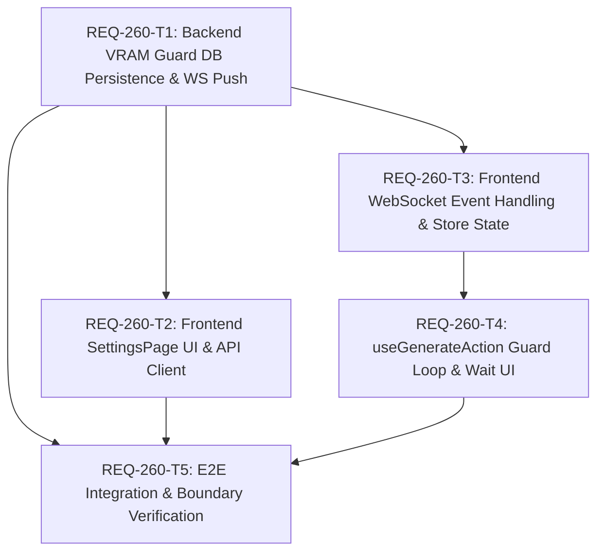

# Implementation Plan - REQ-260: ComfyUI生成開始前の他プロセスVRAM競合防止と待機通知 (設定永続化 & WebSocketプッシュ駆動)

## Executive Summary
Prompt Surgeonホスト上でローカルLLM等の他プロセスがVRAMを消費している最中にComfyUI生成が開始されると、VRAM枯渇（CUDA Out of Memory）によるフリーズやクラッシュが発生する。
本計画では、ユーザーレビュー指摘に基づき：
1. **安全基準値の心もとなさ解消とDB永続化**: デフォルト基準値を **6.0GB** に引き上げ、バックエンドSQLite（`app_settings` テーブル）で永続化し、`SettingsPage` からスライダーで動的調整可能なUIを提供する。
2. **WebSocketプッシュ駆動の確立**: クライアント主体のHTTP定期ポーリングを完全廃止し、既存のFastAPI WebSocketインフラ（`/api/ws`）を活用したイベント駆動型通知（`SYSTEM_STATS` 2.5秒プッシュ配信および `VRAM_RECOVERED` 即時回復通知）により、無駄な通信負荷をかけず即座に生成自動再開を実現する。

---

## Architectural Design & DAG Dependency Graph

- **最大依存深度**: 3層（T1 -> T3 -> T4 -> T5）
- **並行性**: T1（バックエンドDB/API）完了後、T2（SettingsPage UI）とT3（ストア基盤）は並行実行可能。T4（生成ループ・待機UI）はT3完了後に着手。

---

## Task Decomposition & Atomicity Audit

| Task ID | タイトル | 変更対象ファイル (<= 3) | 推定行数 (<= 300) | 検証コマンド |
|---|---|---|---|---|
| **REQ-260-T1** | バックエンド VRAM安全判定・設定永続化API及びWebSocket通知拡張 | `backend/app/models.py` `backend/app/services/resource_monitor.py` `backend/app/routers/settings.py` | 約110行 | `backend\.venv\Scripts\python -m pytest backend/tests/test_comfy_proxy.py` |
| **REQ-260-T2** | フロントエンド APIクライアント・SettingsPage VRAM設定UI実装 | `frontend/src/api/client.ts` `frontend/src/pages/SettingsPage/components/VramGuardSection.tsx` `frontend/src/pages/SettingsPage.tsx` | 約120行 | `cd frontend; npm run typecheck` |
| **REQ-260-T3** | フロントエンド WebSocketイベント処理及びストア VRAM待機状態管理 | `frontend/src/store/types.ts` `frontend/src/hooks/useSystemStats.ts` `frontend/src/store/slices/jobQueueSlice.ts` | 約80行 | `cd frontend; npx vitest run src/store/__tests__/slices/jobQueueSlice.test.ts` |
| **REQ-260-T4** | 生成前VRAMガード待機ループとデスクトップ・モバイル待機UI実装 | `frontend/src/pages/GeneratePage/hooks/useGenerateAction.ts` `frontend/src/pages/GeneratePage/components/DesktopLayout.tsx` `frontend/src/pages/GeneratePage/components/MobileLayout.tsx` | 約130行 | `cd frontend; npm run typecheck` |
| **REQ-260-T5** | E2E結合シナリオ及びRed Team境界値検証 (設定永続化・WebSocketイベント駆動) | `backend/tests/test_vram_guard.py` `frontend/src/test/e2e_req260_vram_guard.test.ts` | 約180行 | `backend\.venv\Scripts\python -m pytest backend/tests/test_vram_guard.py && cd frontend; npx vitest run src/test/e2e_req260_vram_guard.test.ts` |

**アトミシティ判定**: 全タスクが「変更ファイル数 3以下」「総行数 300行以下」を満たしており **PASS**。

---

## Trade-off Disclosure & Technical Decisions

### 1. 基準値設定のBE永続化とSettingsPageへの露出（ユーザー指摘反映）
- **検討**:
  - ハードコード（4.0GB等）やクライアント側localStorageのみでの保持では、マルチデバイス間での不整合やバックエンド単体での判定が困難。
- **決定理由**:
  - バックエンドSQLiteの `app_settings` テーブルで永続化し、`GET/PUT /api/settings/vram` を提供。
  - デフォルト基準値をより安全な **6.0GB** に引き上げ、さらにユーザーが自分のGPU容量（8GB, 12GB, 16GB, 24GB等）に合わせてSettingsPageから即座に調整できる柔軟性を確立。

### 2. HTTP定期ポーリングの完全廃止とWebSocketプッシュ通知の採用
- **検討**:
  - 定期ポーリングはネットワークノイズとサーバー負荷を招き、回復検知に最大ポーリング間隔分の遅延が生じる。
- **決定理由**:
  - バックエンド `ResourceMonitorService` からのプッシュ配信（2.5秒 `SYSTEM_STATS` および遷移時 `VRAM_RECOVERED`）を採用。フロントエンドはZustandストア購読でリアクティブに待機し、回復検知からミリ秒単位で生成を自動再開。

### 3. キャンセル冪等性の担保
- **検討**:
  - 待機キャンセル（AC-4）とVRAM回復（AC-5）がほぼ同時に発生した場合のレースコンディション。
- **決定理由**:
  - `abortSignal` ガードにより、一度キャンセルされた待機プロミスは後続の回復イベントを一切受け付けず、直ちにアイドル状態を維持する排他制御を徹底。

---

## Local Model BA Audit Reflection
- **実施モデル**: `qwen3.5-9b-claude-4.6-highiq-instruct-heretic-uncensored` (Domain: General/Reasoning, Params: 9.0B, Quant: custom)
- **監査結果の反映**:
  1. ユーザー指摘の「基準値心もとなさ」に対応し、6.0GBへの引き上げとDB永続化・Settings UIの導入。
  2. キャンセルと回復の競合（AC-4 vs AC-5）に対するキャンセル冪等性ガードの設計組み込み。
  3. WebSocket切断時の指数バックオフ再接続＋HTTPフェイルセーフ照会によるハング防止。
- **GPUリソース解放**: `local_model_adapter.py unload` を実行し、VRAM 100%解放を確認完了（Exit Code 0）。
