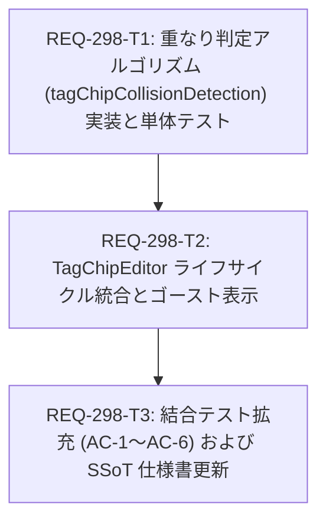

# Implementation Plan: REQ-298

## Target and Current State

REQ-298 は `TagChipEditor` におけるタグチップのドラッグ並び替え判定を、従来の「要素中心点距離（`closestCenter`）」から「要素重なり判定（20%以上の重複面積またはポインタ侵入）」へと改善し、境界チャタリング防止（ヒステリシス制御）、範囲外ドロップ/Escapeによる確実なキャンセル、編集中チップの自動確定（Blur Commit）、既存チップ操作（テキストクリック、強度調整、削除）への非干渉を保証する。
PBI ステータスは `in-progress`。本計画の承認後、物理生成済みのタスクカード（`REQ-298-T1.md` 〜 `REQ-298-T3.md`）に従って TDD 実装を進める。

## SSoT and Boundary Audit

- **SSoT 仕様書**: `docs/specs/SPEC_COMMON.md` §3-5（チップのインタラクション仕様）
- **対象サブシステム**: `frontend`（UI/インタラクション改善のためバックエンド変更および API 変更は不要）
- **影響ファイル**:
  - `frontend/src/components/TagChipEditor/tagChipCollisionDetection.ts` (新規)
  - `frontend/src/components/TagChipEditor/__tests__/tagChipCollisionDetection.test.ts` (新規)
  - `frontend/src/components/TagChipEditor/index.tsx` (改修)
  - `frontend/src/components/TagChipEditor/TagChip.tsx` (改修)
  - `frontend/src/components/TagChipEditor/__tests__/TagChipEditor.test.tsx` (改修)
  - `docs/specs/SPEC_COMMON.md` (SSoT 更新)

## Mermaid DAG

タスク依存は T1 (幾何・アルゴリズム単体) → T2 (コンポーネント統合) → T3 (網羅的結合テスト・SSoT 同期) の順序で進行する。最大深度は 3 層であり、各タスクは明確に責務が分離されている。

## Atomicity Audit and Verification Commands

| タスクID | 対象ファイル | 依存 | 変更行数目安 | 検証コマンド (Verification Command) |
|---|---|---|---:|---|
| **REQ-298-T1** | `frontend/src/components/TagChipEditor/tagChipCollisionDetection.ts` `frontend/src/components/TagChipEditor/__tests__/tagChipCollisionDetection.test.ts` | なし | ≤250行 | `cd frontend; npx vitest run src/components/TagChipEditor/__tests__/tagChipCollisionDetection.test.ts` `cd frontend; npm run typecheck` |
| **REQ-298-T2** | `frontend/src/components/TagChipEditor/index.tsx` `frontend/src/components/TagChipEditor/TagChip.tsx` | T1 | ≤120行 | `cd frontend; npx vitest run src/components/TagChipEditor/__tests__/TagChipEditor.test.tsx` `cd frontend; npm run typecheck` |
| **REQ-298-T3** | `frontend/src/components/TagChipEditor/__tests__/TagChipEditor.test.tsx` `docs/specs/SPEC_COMMON.md` | T2 | ≤200行 | `cd frontend; npx vitest run src/components/TagChipEditor/__tests__/TagChipEditor.test.tsx` `cd frontend; npm run typecheck` |

すべてのタスクカードは 3 ファイル以下かつ 300 行以内のアトミック基準を満たしている（PASS）。

## Three-Gate Testing Strategy

- **Gate 1 (静的型検査)**:
  - `cd frontend; npm run typecheck`（エラー 0 件）
- **Gate 2 (全テスト自動実行)**:
  - `cd frontend; npm test`（リグレッションなし、全通過）
- **Gate 3 (シナリオ・Red Team 検証)**:
  - `docs/design/REQ-298-test-plan.md` に記載の 5 シナリオおよび 3 つの Red Team 境界値（微小接触除外、N=1 / 空要素安全性、極小・極長チップ境界判定）の検証。

## Trade-off Disclosure and Technical Constraints

1. **ポインタ内包優先 vs 面積重複優先 (AC-1, AC-3)**:
   - *検討内容*: 面積重複のみで判定すると、極端に長いタグ（例: `(masterpiece, best quality:1.2)`）に対して小さなタグを重ねた際、相手の20%面積を満たすために深く運ばなければならず「中心点判定」と似たストレスが生じる。
   - *決定*: 「重複面積20%以上」または「ポインタが相手矩形内に入った」のいずれかで発火（OR条件）とし、さらに複数重複時はポインタ直下の要素を最優先する。これにより、極短・極長のタグが混在しても直感的な操作感を両立する。
2. **境界ジッター抑制のヒステリシス閾値 (AC-3)**:
   - *検討内容*: 毎フレーム単純に重複率が大きい方を採用すると、チップ境界でドラッグチップを静止させた際に 1px の揺らぎや DOM 再配置で選択要素が交互に反転し、チラつき（チャタリング）が発生する。
   - *決定*: `lastActiveCollisionId` を追跡し、競合する新候補が前回の候補の重複率を `EPSILON = 0.05` (5%) 以上上回らない限り切り替えないヒステリシス制御を導入する。
3. **範囲外ドロップによる安全なキャンセル (AC-4)**:
   - *検討内容*: `@dnd-kit/core` 標準の `closestCenter` は有効領域を外れても最寄りの要素を返し続けるため、画面外へドラッグして離すキャンセル操作が行えなかった。
   - *決定*: タグチップ一覧の全要素で重複閾値（20% / ポインタ内包）を満たさない場合は空配列 `[]` を返し、`over = null` とすることでスロットプレビューを元の並び順へ自然復帰させ、ドロップ時も順序更新を発生させない。

## Related Documentation

- **設計書**: `docs/design/REQ-298.md`
- **テスト計画**: `docs/design/REQ-298-test-plan.md`
- **PBI**: `docs/backlog/pbi/active/REQ-298.md`
- **タスクカード**:
  - `docs/backlog/task/active/REQ-298-T1.md`
  - `docs/backlog/task/active/REQ-298-T2.md`
  - `docs/backlog/task/active/REQ-298-T3.md`

