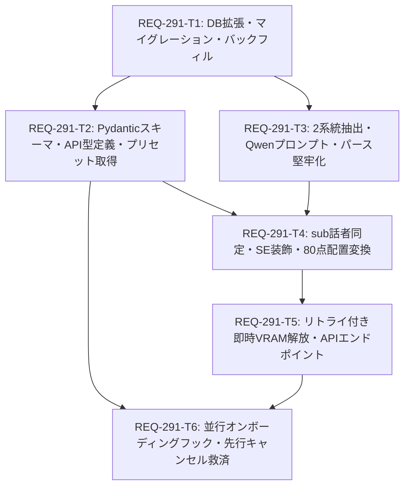

# REQ-291 実装計画書: Prompt Surgeon 2系統参照型セリフ・SE一括自動生成

## 1. 概要 (Overview)
本計画は、Prompt Surgeon における漫画的セリフ・効果音（SE）生成の品質向上と、ローカル 16GB VRAM 環境における ComfyUI との GPU 排他共存を実現するための「2系統参照型セリフ・SE一括自動生成」機能（REQ-291）の実装計画です。一次情報である確定設計書（Rev.14 最終確定版）に完全準拠し、データベース拡張から推論足回り、並行オンボーディング UI までの 6 つのアトミックタスクで構成されます。

---

## 2. 依存関係グラフ (Mermaid DAG)

---

## 3. タスク一覧と受入基準 (Task Breakdown)

| タスクID | タイトル | 担当レイヤー | 依存先 | 変更予定ファイル | 検証コマンド |
|---|---|---|---|---|---|
| **REQ-291-T1** | データベース拡張とマイグレーション・バックフィル | Backend (DB) | なし | `backend/app/models.py` `backend/app/migrations/steps.py` `backend/tools/migrate_speech_speakers.py` | `cd backend && pytest tests/test_speech_migrations.py -v` |
| **REQ-291-T2** | Pydantic スキーマ定義・APIクライアント型定義とプリセット取得 | Backend / Frontend | REQ-291-T1 | `backend/app/schemas/speech.py` `backend/app/schemas/speech_bubble_preset.py` `backend/app/routers/speech_bubble_presets.py` `frontend/src/api/types.ts` `frontend/src/api/client.ts` | `cd backend && pytest tests/test_speech_bubble_presets.py -v` `cd frontend && npm run typecheck` |
| **REQ-291-T3** | 2系統リファレンス選定アルゴリズムとQwenプロンプト・パース堅牢化 | Backend (Service) | REQ-291-T1 | `backend/app/services/speech_scene_service.py` `backend/tests/test_speech_scene_service.py` | `cd backend && pytest tests/test_speech_scene_service.py -k test_dual_track_and_parse -v` |
| **REQ-291-T4** | sub話者TagSet同定・SE装飾解決と80点ハイブリッド実ピクセル座標変換 | Backend (Service) | REQ-291-T2 REQ-291-T3 | `backend/app/services/speech_scene_service.py` `backend/tests/test_speech_scene_service.py` | `cd backend && pytest tests/test_speech_scene_service.py -k test_style_and_coords -v` |
| **REQ-291-T5** | リトライ付き即時VRAM解放・エンドポイントPOST /api/speech/scene-draft実装 | Backend (API) | REQ-291-T4 | `backend/app/services/speech_scene_service.py` `backend/app/routers/speech_scene.py` `backend/app/main.py` `backend/tests/test_speech_scene_service.py` | `cd backend && pytest tests/test_speech_scene_service.py -k test_vram_unload -v` |
| **REQ-291-T6** | フロントエンド並行オンボーディングフックと救済描画・統合 | Frontend (Hook) | REQ-291-T2 REQ-291-T5 | `frontend/src/hooks/useSceneSpeechGeneration.ts` `frontend/src/hooks/__tests__/useSceneSpeechGeneration.test.ts` | `cd frontend && npx vitest run src/hooks/__tests__/useSceneSpeechGeneration.test.ts` `cd frontend && npm run typecheck` |

---

## 4. 技術的トレードオフと設計決定事項 (Trade-offs & Constraints)

1. **VLM座標推定精度のトレードオフ (80点ハイブリッド配置の採用)**:
   - *課題*: VLMに厳密なピクセル座標（100点）を出力させようとするとプロンプトが肥大化し推論精度やセリフの演技力が低下する。
   - *決定*: 定性的な空き方角（`top_right`, `top_left`, `center_right` 等）のみをVLMに粗判定させ、バックエンドが 1024×1024px の安全実ピクセル絶対座標へマッピングするハイブリッド方式を採用。
2. **GPUメモリ排他制御 (推論直後即時アンロード)**:
   - *課題*: VLMモデルをメモリに常駐させるとセリフ推論のレイテンシは短縮されるが、ComfyUIの画像生成（16GB VRAM環境）と競合して CUDA OOM を引き起こす。
   - *決定*: `finally` 句内で LM Studio の `POST /v1/models/unload` を最大1回リトライ付きで即時呼び出し、推論完了直後に確実に VRAM を初期解放するライフサイクルを徹底。
3. **初出キャラの非同期オンボーディング合流レース防止**:
   - *課題*: 初出キャラの場合にプリセット作成を待つとユーザー体験が損なわれる一方、並行推論を行うとモーダル確定と推論完了のタイミング競合（レースコンディション）やキャンセル時のセリフ消失リスクが生じる。
   - *決定*: 3つのRef（`isCancelledRef`, `createdPresetIdRef`, `pendingDraftResultRef`）によるステート追跡を行い、モーダル先行・推論先行・先行キャンセルの全ケースでセリフが確実にキャンバスへ描画される救済機構を確立。
