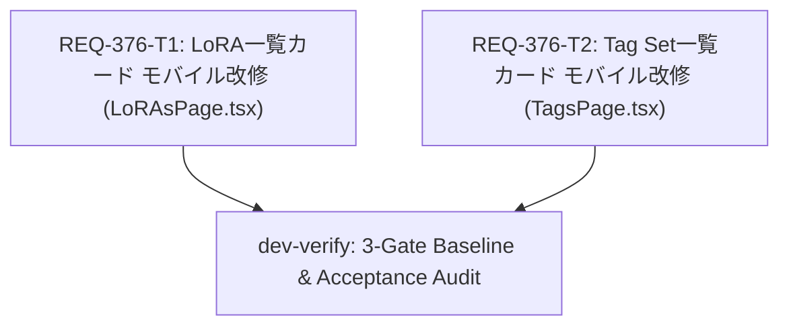

# Implementation Plan: REQ-376 モバイルLoRA／Tag Set：一覧カードの情報整理と縦スクロールの一本化

モバイル環境（幅767px以下）におけるLoRA一覧（`/loras`）およびTag Set一覧（`/tags`）のカード情報整理、内部独立スクロールの撤去、編集・削除ボタン配置適正化、サムネイル中央配置、Stickyカテゴリ見出しの空隙解消を実施する。

---

## Problem Analysis and Overview

1. **ボタンの重なりとタップ誤爆**:
   カード右上に配置されている編集（Pencil）と削除（Trash2）ボタンのタップ可能領域が近接または重複しており、モバイル端末上で意図しない削除確認や誤タップを誘発していた。
2. **入れ子スクロールによるページ縦スクロールの阻害**:
   カード下部が固定高さ内で `overflow-y-auto` による独立スクロールを持っており、一覧を指でスクロールしようとした際にカード内部のスクロールが奪われ、ページ全体のスクロールが途切れていた。
3. **一覧カードの情報過多**:
   一覧カード内にカテゴリバッジ、タグチップ、トリガーワード、強度、ファイルパスなどが詰め込まれ、識別に重要な情報（タイトル、説明、対象Base Model）が見づらくなっていた。
4. **Sticky見出しの浮き・空隙**:
   スクロール親コンテナのパディング設定（`p-5`）により、カテゴリ見出しがSticky吸着した際に上部に不自然な20pxの空隙が発生していた。
5. **サムネイル画像の寄り**:
   画像フレームが左寄せになっており、固定幅カード内で中央に配置されていない。

---

## Architectural Design and Layout Strategy

- **固定カード高 320px の維持**: モバイルグリッドの列高さの均一性を保つため、カード外形は `h-[320px]` を維持。
- **下部情報の3項目厳格制限**: モバイル時のみ、下部を「①タイトル（最大2行）」「②Description（最大2行）」「③対象Base Model（1行、下端揃え）」の3項目のみとし、他は非表示。
- **内部スクロール全廃**: 下部情報コンテナを `overflow-hidden` に変更し、縦スクロールジェスチャーをページコンテナに一本化。
- **カテゴリの集約**: カード内のカテゴリバッジを非表示化し、Stickyカテゴリ見出しに一元化。
- **ボタン分離**: 削除を `top-1 right-1`（44×44px）、編集を `top-1 right-[50px]`（44×44px）に配置し、重なりを物理的に排除。
- **画像中央配置**: 共有コンポーネント `ImageCarousel` 本体を変更せず、ページ側の指定（Tailwind任意セレクタ）で中央配置を実現。
- **デスクトップ（>=768px）Baseline維持**: `md:` レスポンシブプレフィックスを活用し、PC表示時は従来のトリガーワードコピー、タグチップ、カード内スクロールを100%維持。

---

## Proposed Changes

### Frontend Implementation

#### `frontend/src/pages/LoRAsPage.tsx` [Task: REQ-376-T1]
- `renderLoraCard`:
  - `ImageCarousel` に中央寄せ用クラスを付与。
  - 編集ボタン・削除ボタンのタップ領域を44×44px確保し、配置を分離。
  - カード下部情報エリアをモバイル用（3項目固定・`overflow-hidden`）とデスクトップ用（従来Baseline・`md:overflow-y-auto`）に分岐。
  - 対象Base Modelの複数件フォーマット（`names.join(' · ')` / `対象モデル未設定`）とツールチップを実装。
- スクロールコンテナ:
  - `p-5 pt-0 md:pt-5` に修正し、Stickyカテゴリ見出しの上端空隙を解消。

#### `frontend/src/pages/TagsPage.tsx` [Task: REQ-376-T2]
- `renderTagSetCard`:
  - `ImageCarousel` に中央寄せ用クラスを付与。
  - 編集ボタン・削除ボタンのタップ領域を44×44px確保し、配置を分離。
  - カード下部情報エリアをモバイル用（3項目固定・`overflow-hidden`）とデスクトップ用（従来Baseline・`md:overflow-y-auto`）に分岐。
  - 対象Base Modelの複数件フォーマット（`names.join(' · ')` / `対象モデル未設定`）とツールチップを実装。
- スクロールコンテナ:
  - `p-5 pt-0 md:pt-5` に修正し、Stickyカテゴリ見出しの上端空隙を解消。

---

## Verification Plan

### Test Placement Plan
- `frontend/src/pages/__tests__/LoRAsPage.test.tsx` (拡張)
- `frontend/src/pages/__tests__/TagsPage.test.tsx` (拡張)
- `frontend/src/pages/__tests__/AssetCardInteractions.test.tsx` (拡張)
※ 新規チケット番号付きテストファイルは作成しない。各テストケースに `[REQ-376/AC-n]` タグを付与。

### Exact Verification Commands
```bash
# 1. 静的型検査
cd frontend && npm run typecheck

# 2. LoRAページ単体・受入テスト
cd frontend && npm test -- --run src/pages/__tests__/LoRAsPage.test.tsx -t "REQ-376"

# 3. Tag Setページ単体・受入テスト
cd frontend && npm test -- --run src/pages/__tests__/TagsPage.test.tsx -t "REQ-376"

# 4. ボタン配置・競合テスト
cd frontend && npm test -- --run src/pages/__tests__/AssetCardInteractions.test.tsx -t "REQ-376"

# 5. 全件回帰テスト
cd frontend && npm test
```

---

## Mermaid DAG



---

## Trade-offs and Risk Disclosure

1. **一覧からの個別コピー導線の詳細画面への集約 (AC-8)**
   - *Trade-off*: モバイル一覧画面からトリガーワードやタグをワンタップで直接コピーする機能が省略され、詳細画面を開いてコピーする導線に一本化される。
   - *Rationale*: 一覧カード内に小さなボタン群を詰め込むことによる誤タップおよび独立スクロールの弊害を排除し、一覧の本来目的である「素早い識別と快適なスクロール」を最優先とする（ユーザーレビューで合意・許容済み）。
2. **共有コンポーネント `ImageCarousel` の本体不改変方針 (AC-7)**
   - *Trade-off*: `ImageCarousel.tsx` の内部CSS（`absolute left-0`）を変更せず、ページ側から親・子セレクタを通じて中央寄せを適用する。
   - *Rationale*: `ImageCarousel` は他画面（Generate等）でも広く使用されており、グローバル変更による他画面への予期せぬ表示崩れ（リグレッション）を防止するため。
3. **複数Base Modelの省略と全文確認 (AC-9)**
   - *Trade-off*: 対象Base Modelが多数ある場合、一覧カード上では ` · ` で結合された上で末尾が `…` に省略される。
   - *Rationale*: カード高320pxの厳格な固定とレイアウト崩れ防止のため、一覧では1行に収め、全件確認はカードタップ（詳細モーダル）で行う設計とした。
