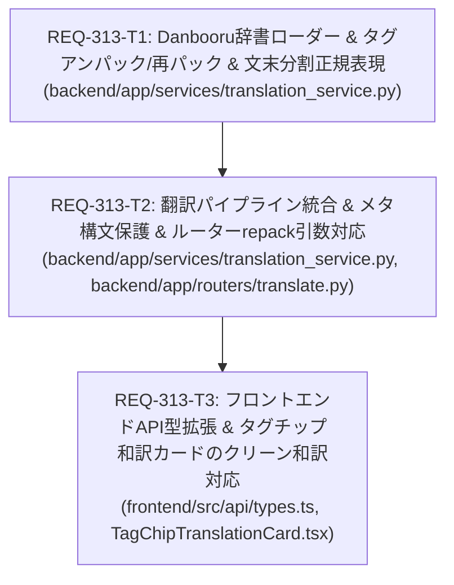

# Implementation Plan - REQ-313: Prompt Surgeon: FuguMT翻訳エンジンの高度化（文末分割・強度タグ正規化・Danbooru辞書引き統合）

FuguMT（Marian-NMT）における複数文の自然文での訳抜け、強調構文（重み括弧）の翻訳スキップや推論乱れ、およびアニメ・Danbooru特有タグの直訳・誤訳を解消するため、`translation_service.py` に文末ピリオド分割・強度タグアンパック・Danbooru日英対訳辞書（ZIP/CSV）先行照会・再パックパイプラインを統合し、フロントエンドのタグカードでクリーンな純粋日本語表示を可能とする。

## Proposed Changes

### Backend Subsystem

#### [LOCAL MODIFY] [backend/app/services/translation_service.py](file:///c:/Users/audih/ws/comfy-create-helper2/backend/app/services/translation_service.py)
- `SPLIT_PATTERN = re.compile(r"([,、\n\r]+\s*|(?<![\d.])\.(?![\d.])(?:\s+|$)|[。！？!?]+\s*)")` を定義し、重み小数や三点リーダーを壊さずに文末ピリオド・カンマ等で分割。
- `unpack_tag(chunk: str)` を実装し、外側の括弧群・コロン重み数値を分離してアンダースコアを空白化。
- `repack_tag(translated_core: str, prefix: str, weight: Optional[float | str], suffix: str)` を実装し、元の強度構文を再パック。
- `load_danbooru_dict(force_reload: bool = False)` を実装し、`tmp/danbooruTagCompleteCsv_v1020250919.zip` や CSV ファイルから代表訳をインメモリ辞書にロード。ファイル未検出時も Graceful Degradation で安全に FuguMT へフォールバック。
- `sanitize_and_tokenize` のパターンを `<lora:...>`, `<hypernet:...>`, `embedding:...` などの純粋メタ構文のみに限定。
- `translate_prompt` に `repack: bool = True` 引数を追加し、辞書先行照会（0ms 確定）、未登録分のみの FuguMT バッチ推論、`repack` フラグに基づく出力フォーマット制御（プロンプト置換用再パック / タグカード用クリーン日本語）、および元の区切り記号を維持した再結合を実装。

#### [LOCAL MODIFY] [backend/app/routers/translate.py](file:///c:/Users/audih/ws/comfy-create-helper2/backend/app/routers/translate.py)
- `PromptTranslateRequest` に `repack: Optional[bool] = True` フィールドを追加。
- `translate_prompt_endpoint` で `repack` 引数を `translation_service.translate_prompt` に伝播。

#### [LOCAL MODIFY] [backend/tests/test_translation_proxy.py](file:///c:/Users/audih/ws/comfy-create-helper2/backend/tests/test_translation_proxy.py)
- 文末ピリオド分割（`test_split_pattern_with_periods_and_weights`）、強度アンパック/再パック（`test_unpack_and_repack_weight_tags`）、Danbooru辞書先行ヒット（`test_danbooru_dict_lookup_priority`）、辞書未配置フォールバック（`test_missing_dictionary_fallback_to_fugumt`）、`repack` 出力制御（`test_repack_parameter_control`）、メタ構文保護（`test_meta_syntax_protection_intact`）のテストケースを追加・更新。

### Frontend Subsystem

#### [LOCAL MODIFY] [frontend/src/api/types.ts](file:///c:/Users/audih/ws/comfy-create-helper2/frontend/src/api/types.ts)
- `PromptTranslateRequest` インターフェースに `repack?: boolean;` を追加。

#### [LOCAL MODIFY] [frontend/src/components/TagChipEditor/TagChipTranslationCard.tsx](file:///c:/Users/audih/ws/comfy-create-helper2/frontend/src/components/TagChipEditor/TagChipTranslationCard.tsx)
- `fetchTranslation` 内で `translateApi.translatePrompt` を呼び出す際、`repack: false` を指定して強度括弧のない純粋な日本語を表示。

#### [LOCAL MODIFY] [frontend/src/components/TagChipEditor/__tests__/TagChipTranslationCard.test.tsx](file:///c:/Users/audih/ws/comfy-create-helper2/frontend/src/components/TagChipEditor/__tests__/TagChipTranslationCard.test.tsx)
- `repack: false` が渡されることの検証および重みタグ表示テストケースを追加・更新。

---

## Verification Plan

### Automated Baseline 3-Gate Verification

1. **Gate 1: Static Typecheck**
   ```powershell
   mypy backend
   cd frontend; npm run typecheck
   ```
2. **Gate 2: Unit & Regression Tests**
   ```powershell
   backend\.venv\Scripts\python -m pytest backend/tests/test_translation_proxy.py -v
   cd frontend; npx vitest run src/components/TagChipEditor/__tests__/TagChipTranslationCard.test.tsx
   ```
3. **Gate 3: Integration & Red Teaming**
   - 複数文自然文プロンプト（`A girl smiles. She reads a book.`）での訳抜け防止検証。
   - 強度タグ（`((ahoge:1.2))`）でのタグカード表示（`アホ毛`）とプロンプト置換（`((アホ毛:1.2))`）の差別化検証。
   - Danbooru特有タグ（`cat_ears` -> `猫耳`）の 0ms 辞書ヒット確認。
   - 不正構文・辞書未配置時の Graceful Degradation 検証。

---

## Task Decomposition & Parallelism DAG



- **依存構造**:
  - `REQ-313-T1`: バックエンド基礎ユーティリティ（辞書ロード、アンパック/再パック、正規表現）。
  - `REQ-313-T2`: `translate_prompt` パイプライン統合および FastAPI ルーター拡張（T1 に依存）。
  - `REQ-313-T3`: フロントエンド型拡張およびタグカード UI 連携（T2 の API 定義完了後に結合）。

---

## Trade-off Disclosure

1. **ZIP内CSVのインメモリ保持（約8MBメモリ）**:
   - `tmp/danbooruTagCompleteCsv_v1020250919.zip` 内の `danbooru_translations_jp.csv`（約4.1万語彙）を起動時または初回呼出時にインメモリ保持（約 8MB メモリ消費）。ディスク展開を不要とし、75ms での即座ロードと O(1) ハッシュテーブル照会（0.01ms）を実現。
2. **多重同義語における代表訳の選定**:
   - CSV 内に `cat_ears -> 猫耳,ネコミミ,ねこみみ,ネコ耳` のようにカンマ区切りで複数の表記揺れが含まれる場合、タグカードやプロンプト置換の簡潔性と可読性を最優先し、先頭の代表表記（`猫耳`）を採用。
3. **文末ピリオド判定の安全性**:
   - `(?<![\d.])\.(?![\d.])(?:\s+|$)` を用いて、重み指定の小数点（`:1.2`）や三点リーダー（`...`）を誤って分割しない安全性を担保。
