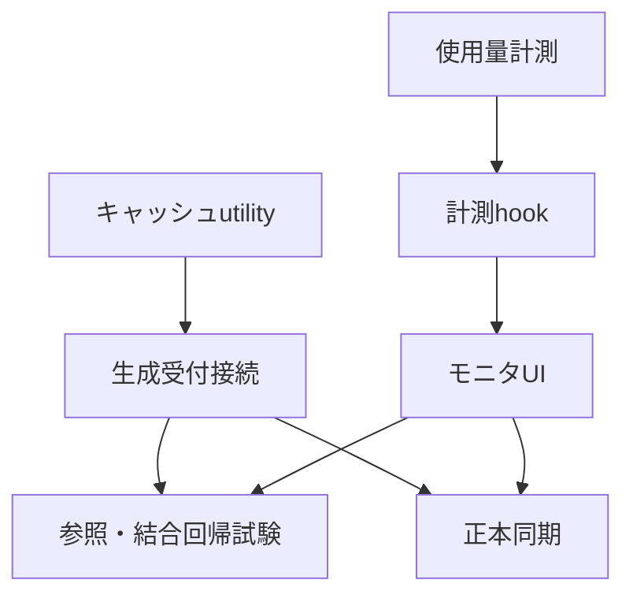

# REQ-317 実装計画

## 承認済み範囲

`prompt-surgeon-meta-*` の生成時メタ情報キャッシュを200件から30件へ縮小し、生成受付に伴うlocalStorage書込み前に整理する。初回生成時も既存超過分を整理する。server metadata（1000件）、画像履歴、設定、snapshot、cache hit即時表示、server fallback、local/serverの独立保存失敗動作は維持する。desktop/mobileのリソースモニタに現在originのlocalStorageと現在tabのsessionStorageの推定使用量を追加する。

REQ-312の目的は重複表示を減らして簡潔にすること。3行固定は適用せず、必要な行追加を許容する。

## 依存DAG

| Card | 対象 | 依存 | 検証 |
|---|---|---|---|
| T1 | `promptMetadataCache.ts`、単体試験、`localStorageKeys.ts` | なし | 対象Vitest + typecheck |
| T2 | `jobQueueSlice.ts`と試験 | T1 | 対象Vitest + typecheck |
| T3 | `browserStorageUsage.ts`と単体試験 | なし | 対象Vitest |
| T4 | `useBrowserStorageUsage.ts`と試験 | T3 | fake timer付きVitest |
| T5 | HUD、Chips、統合component試験 | T4 | desktop/mobile Vitest |
| T6 | prompt record、history preview、E2E試験 | T2,T5 | Vitest + `src/test/e2e_req317_storage.test.tsx` |
| T7 | SPEC_GENERATE、SPEC_HISTORY | T2,T5 | 用語/上限と実装の整合レビュー |

T1とT3は並行可能。各Taskは変更300行以下とし、超過する場合は設計レビューへ戻す。frontend typecheck、対象Vitest、全Vitest、E2Eを `REQ-317-test-plan.md` に記載の通り実行する。

## 設計レビューで確認するリスク

- 初回整理は不可逆で、server未保存記録の無損失は保証しない。
- 30件は件数上限であり、巨大な1件や他originデータによる容量不足は残り得る。
- UTF-16推定量はbrowser quota/ディスク使用量と一致しない。大量保存では定期列挙の負荷がある。
- 複数tabでの厳密な書込み順序と領域全体の原子的snapshotは対象外。
- BA監査はINCONCLUSIVEのまま維持し、unload結果をPASSとみなさない。

T1〜T7は実装完了。型チェックと全体テストは成功。2026-10-05、表示確認後のユーザー指示によりクローズ。手動未検証範囲と監査結果はdocs/walkthrough-REQ-317.mdに保持する。
