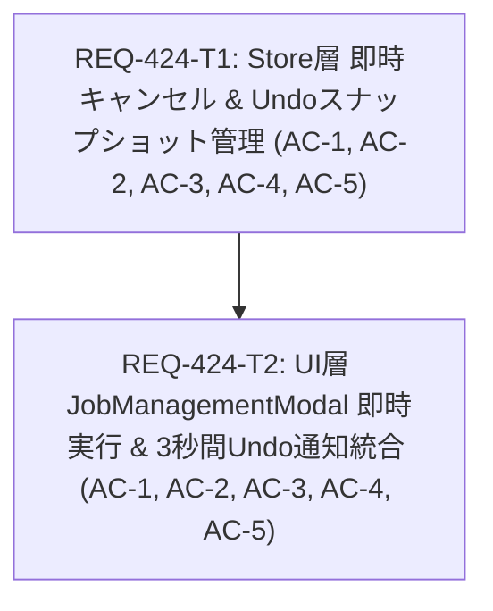

# Implementation Plan: REQ-424 生成キューの単一キャンセル即時実行と3秒間アンドゥ機能

## Overview
生成キュー（`queuePending`）内の特定待機ジョブをキャンセルする際、誤操作防止ガードとして存在していた固定の3秒事前ディレイ（待機カウントダウン）を廃止し、操作と同時に即座にキューから除外・キャンセルを実行する即応型インタラクションへと刷新します。
同時に、誤操作によるジョブ喪失を防ぐ安全策として、キャンセル実行直後から3秒間「取り消し（Undo）」アクションを伴う通知UIを表示し、3秒以内の取り消し操作により元のワークフロー・パラメータ設定を保持した状態でキューに即座に復帰できる事後救済機構を提供します。

---

## User Review Required
> [!IMPORTANT]
> **主要な設計判断と方針（設計書 `docs/design/REQ-424.md` 参照）**
> - **事前ディレイから事後救済（Undo）への転換 (AC-1, AC-2)**: 従来の「ボタンを押してから3秒待たされる」仕様を撤廃し、即座にキャンセル処理を実行（`generationApi.cancelJob(promptId, false, true)`）して待機キューから除外します。直後に3秒間の有効期限タイマーを持つUndo通知を表示します。
> - **完全なパラメータ・ワークフロー復元 (AC-3)**: キャンセル直前のジョブ構成情報（ワークフローJSON、パラメータ値、プロンプト、適用アセット、ワークフローID）をスナップショットとして退避し、3秒以内に「取り消し」が押下された際は `queuePrompt` 経由で元の設定のまま確実にキューへ復帰させます。
> - **自然確定と手動消去 (AC-4)**: 3秒が経過した場合、またはユーザーが通知の「×」ボタンを押した場合はUndoスナップショットを破棄し、キャンセルの確定状態を決定論的に維持します。
> - **一括キャンセルおよび実行中ジョブ中断の保護 (AC-5)**: 全件キャンセル（`cancelAllJobs`）や待機中一括クリア（`clearPendingQueue`）、および実行中ジョブの緊急停止（Abort/Interrupt）はUndoの対象外とし、既存の確認モーダル・即時停止動作を一切変更しません。

---

## Proposed Changes

### Frontend Subsystem: Store & Undo State Management
#### [REQ-424-T1] 生成キューの即時キャンセルとUndoスナップショット管理の実装
- `frontend/src/store/types.ts`:
  - `CancelledJobSnapshot` インターフェースを新設。
  - `JobQueueState` に `queuedCancelUndo: CancelledJobSnapshot | null` を追加。
  - `JobQueueActions` に `cancelQueuedJobWithUndo`, `restoreCancelledJob`, `dismissQueuedCancelUndo` を追加。
- `frontend/src/store/slices/jobQueueSlice.ts`:
  - `cancelQueuedJobWithUndo(promptId)`: 対象ジョブのワークフロー・メタデータを退避し、即座に `generationApi.cancelJob` を実行、3秒タイマーを起動。
  - `restoreCancelledJob()`: 退避データから `queuePrompt` を呼び出してキューへ復元再投入。
  - `dismissQueuedCancelUndo()`: タイマー解除とスナップショット破棄。
- `frontend/src/store/__tests__/slices/jobQueueSlice.test.ts`:
  - 即時キャンセル実行、スナップショット退避、タイマー動作、復元再投入、確定破棄の各ユニットテストを追加。

---

### Frontend Subsystem: UI Integration & Modal Components
#### [REQ-424-T2] JobManagementModalの単一キャンセル即時実行と3秒間アンドゥUI統合
- `frontend/src/components/JobManagementModal.tsx`:
  - 旧3秒ディレイ（`reserveQueuedCancel` によるカウントダウン待機）を完全撤廃。
  - 待機ジョブのごみ箱ボタン押下ハンドラを `cancelQueuedJobWithUndo` の即時呼び出しに置換。
  - キャンセル直後のUndo通知UI（バナー/トースト: 「ジョブをキャンセルしました」、「取り消し」ボタン、閉じるボタン、「3秒以内」インジケーター）を配置。
  - 「取り消し」押下時に `restoreCancelledJob()` を呼び出し、閉じる押下時に `dismissQueuedCancelUndo()` を呼び出す。
  - 実行中ジョブ中断モーダルおよび一括キャンセル動作は既存仕様を維持。
- `frontend/src/components/__tests__/JobManagementModal.test.tsx`:
  - 旧「3000ms待機キャンセル」テストを「即時キャンセル実行」テストへ更新。
  - Undo通知の表示、2999msでのUndo成功、3001msでの失効、閉じる操作による確定、一括キャンセルの保護を網羅するテストケースを追加。

---

## Dependency Graph & Implementation DAG

---

## Trade-offs & Risks Disclosure

1. **復元ジョブのキュー投入位置**:
   - 上流 ComfyUI/バックエンドのキューAPIは任意インデックスへの割り込み挿入をサポートしていないため、Undo時の再投入はキューの末尾に追加されます。ただし、「誤って消去したジョブの設定を失わず即座に復旧する」という事後救済の主目的は完全に満たされます。
2. **ブラウザリロード時のUndo寿命**:
   - 3秒間という極めて短い有効期間のため、Undo状態はインメモリ管理（Zustand Store）とします。キャンセル直後にリロードや別ページへの離脱が発生した場合はキャンセル確定となります。過剰なストレージ永続化による複雑性を排除し、安全でクリーンなライフサイクルを維持します。
3. **他セッション待機ジョブの保護**:
   - `filterOwnSession` 有効時は自端末セッション以外の待機ジョブに対してキャンセルボタンが無効化または非表示となる既存ガードを厳格に維持します。

---

## Verification Plan

### Gate 1: 静的型チェック (Typecheck Baseline)
- `cd frontend && npm run typecheck`
  - 期待値: 型エラー 0 件 (Exit code 0)

### Gate 2: ユニット＆結合テスト (Unit / Full Suite Baseline)
- `cd frontend && npm test src/store/__tests__/slices/jobQueueSlice.test.ts`
  - 期待値: 全テスト PASS (Exit code 0)
- `cd frontend && npm test src/components/__tests__/JobManagementModal.test.tsx`
  - 期待値: 全テスト PASS (Exit code 0)
- `cd frontend && npm test`
  - 期待値: フロントエンド全テスト PASS (Exit code 0)

### Gate 3: シナリオ・境界値・Red Teaming検証
- `cd frontend && npm test src/components/__tests__/JobManagementModal.test.tsx -t "REQ-424"`
- `cd frontend && npm test src/store/__tests__/slices/jobQueueSlice.test.ts -t "REQ-424"`
  - 境界値: 2999msでのUndo成功 vs 3001msでのUndo失効確定
  - 異常系: キャンセルAPI障害時のエラー通知、復元時再投入失敗時のフォールバック、連続キャンセル時のタイマー安全競合処理

---

## BA Design Audit
- **Audit Tool**: `local_model_adapter.py ba-audit --audit-kind design`
- **Model**: `qwen/qwen3.5-9b` (Context: 32768, Reasoning: none)
- **Status**: **PASS_NO_FINDINGS** (AC-1〜AC-5の全受入基準カバレッジ確認済み、全ユニット整合性検証完了)
- **GPU Cleanup**: `local_model_adapter.py unload` 実行確認済み（LM Studio reports no models loaded）

