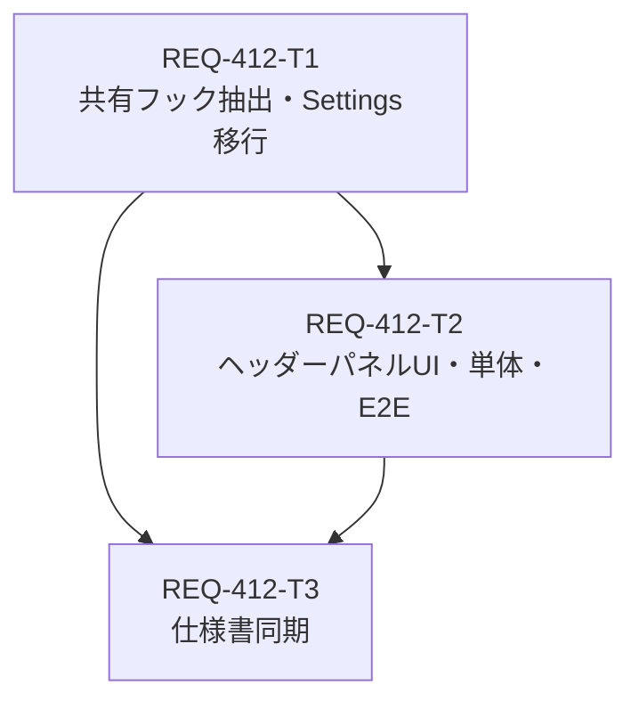

# Implementation Plan - REQ-412: ヘッダーリソースモニタからのComfyUIメモリ解放アクション実行

## User Review Required

> [!IMPORTANT]
> **主要な設計判断（詳細は設計書 [REQ-412.md](docs/design/REQ-412.md)、テスト計画 [REQ-412-test-plan.md](docs/design/REQ-412-test-plan.md)）**
> - **既存ロジックの再利用 = 共有フックへの抽出**: Settings system 欄（`ServiceConnectionCard`）に閉じていた有効条件・理由文言・送信処理（REQ-380）を `frontend/src/hooks/useComfyFreeMemory.ts` に移し、Settings とヘッダーの両方から使います。Manager API（`POST :8899/api/action {"action":"free-memory","service":"comfy"}`）・Manager 側 lock・API の復号/エラー分類は変更しません。
> - **同一タブ内ロックの共有**: Settings とヘッダーのどちらで押しても二重送信しないよう、操作ロックをモジュール共有ストア（`useManagerStatus` と同じ方式）にします。Settings の起動・停止・再起動も同じロックを使うため、片方の操作中はもう片方も無効になります。
> - **配置**: デスクトップのホバーカード（250px）とモバイルのオーバーレイ（240px）の末尾に「ComfyUI メモリ解放」を置きます。`HeaderDropdown`（SPEC_COMMON §4-4-1）は変更しないため、ヘッダー下端＋6px・内部スクロール・末尾到達の契約はそのまま適用されます（AC-7）。
> - **フィードバック**: 結果文言は共有ストアに保持し、カードが閉じても要求は継続し、開き直すと結果を確認できます。受付文言は既存の「解放要求を受け付けました。空き容量は監視値で確認してください」です。
> - **リスク分類 high / V1 Baseline**: 全ページ共通ヘッダー・共有状態・既存アサーション変更を含むため、Gate 2 フルスイートと Gate 3 E2E 全件を必須とします。

> [!WARNING]
> **ご判断いただきたい事項**
> 1. **ホバーカードの role 変更**: 対話要素を含む `role="tooltip"` は a11y 上不適切なため、`tooltip` を外して内容を `role="group"`（`aria-label="リソース詳細"`）で包みます。REQ-346 の既存アサーション 2 箇所（単体・E2E 各 1）と SPEC_COMMON §4-4-1 の対象アクション表を更新します。`tooltip` のまま維持したい場合はお知らせください。
> 2. **未確認時の文言変更（Settings にも影響）**: AC-6 と SPEC_SETTINGS の「要求結果未確認」表示に合わせ、未確認文言の先頭に「要求結果未確認: 」を付けます。Settings の表示も同じ文言になります。
> 3. **全体トーストは採用しない**: 共通トースト基盤がないため、パネル内表示＋再表示で確認できる形にします（PBI の推論事項「望ましい」の範囲）。

## Proposed Changes

### REQ-412-T1: 共有フック抽出と Settings の移行（engineer / frontend）
- [NEW] `frontend/src/hooks/useComfyFreeMemory.ts`（`deriveFreeMemoryGuard`、共有ロック、`useComfyFreeMemory`）
- [NEW] `frontend/src/hooks/__tests__/useComfyFreeMemory.test.ts`（fast-check による guard の性質テスト、故障注入）
- [MODIFY] `frontend/src/pages/SettingsPage/components/ServiceConnectionCard.tsx` と同テスト

### REQ-412-T2: ヘッダーパネルへのボタン配置と E2E（engineer / frontend）
- [NEW] `frontend/src/components/common/header/HeaderFreeMemoryAction.tsx`
- [MODIFY] `frontend/src/components/common/header/ResourceHoverMonitor.tsx` と同テスト
- [MODIFY] `frontend/e2e/headerHoverCard.spec.ts`、`frontend/e2e/headerMenuOverlay.spec.ts`（8899 を `page.route` で切断）

### REQ-412-T3: 仕様書同期（doc-editor / document）
- [MODIFY] `docs/specs/SPEC_COMMON.md` §4-4-1、`SPEC_GENERATE.md`、`SPEC_SETTINGS.md`、`server_manager_guide.md`

## Task DAG

最大深さ 3。T2 は T1 のエクスポート（設計書 D4 で固定）を import するため直列です。T3 は確定後の文言・DOM 契約を反映するため最後に行います。

## Trade-off Disclosure

| 論点 | 採用 | 代替案と不採用理由 |
|---|---|---|
| ロジック再利用 | 共有フック＋純関数へ抽出し Settings も移行 | ヘッダーへ複製すると guard・文言が二重管理になり乖離する |
| 同一タブ内ロック | モジュール共有ストア | React Context は Provider 追加が必要で、ヘッダーを描画する既存テスト多数の修正を誘発する |
| `useQueryClient` | フックでは使わず `onAccepted` で注入 | フック内で使うと QueryClientProvider なしの既存ヘッダーテストが失敗する |
| フィードバック | パネル内表示（共有ストアで保持） | 全体トーストは共通基盤がなく範囲外 |
| ホバーカード role | `tooltip` を外し内側を `group` で包む | `dialog` はフォーカス管理が §4-4-1 の非目標と衝突。`HeaderDropdown` への `aria-label` 追加は共有プリミティブの変更になる |

主なリスク: 旧 Chromium で disabled ボタン上の離脱イベントが出ない可能性（E2E RT-1 で確認）、8899 の CORS・プリフライト（E2E で OPTIONS を明示応答）、カード内容増加による既存 REQ-346/AC-3 E2E の数値変化、queue 確認と /free 間の外部投入競合（Manager 側の既知事項で本 PBI の範囲外）。

## Verification Plan

- Gate 1: `npm.cmd --prefix frontend run typecheck`、`scripts/verify_ui_invariants.py`、`scripts/verify_test_naming.py --strict`、Frontend unit（verification.json 固定コマンド）、mypy/pytest unit
- Gate 2: `backend\.venv\Scripts\python.exe scripts/run_full_suite.py`（必須）
- Gate 3: `backend\.venv\Scripts\python.exe scripts/run_e2e.py`（必須。REQ-412 の E2E 9 系統と REQ-346 の既存マトリクスを含む）
- AC 対応は設計書 D5 とテスト計画 §3 を参照。
