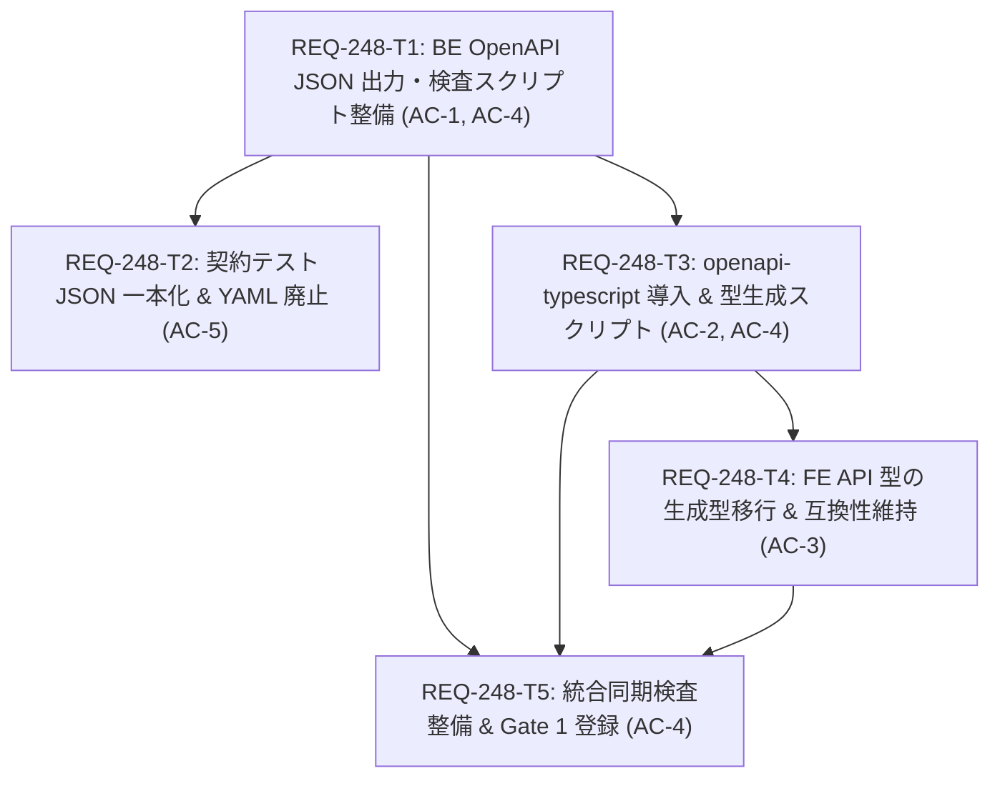

# Implementation Plan: REQ-248 OpenAPI JSONへの一本化とopenapi-typescriptによるFE型生成・同期チェック

## Overview
バックエンド（FastAPI）のAPI定義、`backend/openapi.json`、`docs/openapi.yaml`、およびフロントエンドの型定義（`frontend/src/api/types.ts` 等）の間で生じていた多重管理とスキーマ乖離（Contract Drift）を解消し、OpenAPI 正本を `backend/openapi.json` に一本化します。

サーバー起動や HTTP 通信を介さず静的に再現可能な OpenAPI JSON を出力する CLI スクリプト `scripts/export_openapi.py` を整備し、公式ツール `openapi-typescript` によるフロントエンド型生成を導入します。API層の手書き型を生成型への参照・互換エイリアスへ移行して通信ロジックの互換性を維持し、非更新で乖離を検出する同期検査スクリプトを Gate 1 / CI に組み込みます。また `docs/openapi.yaml` を完全廃止し、契約テストおよび仕様書の参照を JSON 正本へ統一します。

---

## User Review Required
> [!IMPORTANT]
> **主要な設計判断と方針（設計書 `docs/design/REQ-248.md` 参照）**
> - **サーバーレス・副作用ゼロの静的出力 (AC-1)**: `scripts/export_openapi.py` は `from app.main import app` から直接 `app.openapi()` を取得し、ASGI lifespan を起動しません。実DBアクセス、マイグレーション、シーディング、ComfyUI bridge / worker は一切動作せず、完全に決定論的・安全に出力されます。
> - **公式ツール `openapi-typescript` の採用 (AC-2)**: 独自ジェネレータは作成せず、デファクトスタンダードである `openapi-typescript` (`^7.13.0`) を採用します。`npm run openapi:generate` で `frontend/src/api/schema.ts` を生成し、手編集は厳禁とします。
> - **API層の型互換性維持 (AC-3)**: `types.ts` および `domains/generation.ts` の手書き型を `components['schemas']` の型参照・エイリアスへ移行しますが、既存の通信ロジック、応答不明照合（`reconcile` / `unconfirmed`）、再送防止、キャンセル、エラーハンドリングは一切変更せず、コンポーネント側の公開シグネチャとの型互換性を100%維持します。UI専用型は契約外として明示的に分離します。
> - **Contract Drift 防御チェックの Gate 1 統合 (AC-4)**: BE の差分検知（`export_openapi.py --check`）と FE の差分検知（`npm run openapi:check`）を統合した `scripts/verify_openapi_sync.py` を整備し、ファイルを書き換えることなく非ゼロ終了で乖離を検出します。`.agents/context.md` の Gate 1 に登録します。
> - **YAML の完全廃止 (AC-5)**: `docs/openapi.yaml` は物理削除し、`test_openapi_contract.py` および仕様書（`SPEC_SETTINGS.md` 等）の参照先を `backend/openapi.json` に統一します。

---

## Proposed Changes

### Backend & Tooling Subsystem
#### [REQ-248-T1] FastAPI OpenAPI JSON 静的出力・同期検査スクリプト整備
- `scripts/export_openapi.py`:
  - Uvicorn/HTTP不要で `app.openapi()` を取得し、決定的フォーマット（`indent=2`, `ensure_ascii=False`, LF改行）で `backend/openapi.json` を出力・検査する CLI スクリプトを新規作成。
  - `--check` フラグで現在の保存ファイルと生成内容を比較し、差分があれば差分を出力して非ゼロ終了（ファイル書き換えなし）。
- `backend/openapi.json`:
  - 現行 139 paths の完全なスキーマで初回同期更新。
- `backend/tests/unit/test_export_openapi.py`:
  - 副作用なし出力、再現性、および `--check` 差分検出（異常系含む）の単体テストを新規作成。

#### [REQ-248-T2] 契約テストのJSON一本化とdocs/openapi.yaml廃止・仕様同期
- `backend/tests/governance/test_openapi_contract.py`:
  - `docs/openapi.yaml` 読み込みおよびアサーションを削除し、`backend/openapi.json` 単一正本での契約検証へ統一。
- `docs/openapi.yaml`:
  - ファイルを物理削除。
- `docs/specs/SPEC_SETTINGS.md`, `README.md`, `SKILL.md`:
  - 現行の `docs/openapi.yaml` 参照を `backend/openapi.json` に更新。

---

### Frontend Subsystem
#### [REQ-248-T3] openapi-typescript導入と型生成・同期チェックnpmスクリプト追加
- `frontend/package.json`:
  - `devDependencies` に `openapi-typescript` (`^7.13.0`) を追加。
  - スクリプト `"openapi:generate"` および `"openapi:check"` を追加。
- `frontend/src/api/schema.ts`:
  - `openapi-typescript` による完全自動生成型定義ファイルを生成。

#### [REQ-248-T4] FE API層の手書き型の生成型参照への移行と互換性検証
- `frontend/src/api/types.ts`:
  - `schema.ts` の `components['schemas']` を参照する型エイリアス・互換型へリファクタリング。
  - UI専用型を明示的に区別して手書き二重管理を解消。
- `frontend/src/api/domains/generation.ts`:
  - `components['schemas']['JobView']` 等との整合性を確保し、既存通信・照合フローの互換性を完全維持。

---

### System & Verification Subsystem
#### [REQ-248-T5] 統合同期チェックコマンド整備とGate 1/CI検証経路組み込み
- `scripts/verify_openapi_sync.py`:
  - BE差分チェックとFE差分チェックを一括実行し、乖離時に exit 1 で終了する統合同期チェックスクリプトを新規作成。
- `.agents/context.md`:
  - Gate 1 コマンド一覧に `scripts/verify_openapi_sync.py` を登録。

---

## Dependency Graph & Implementation DAG

---

## Trade-offs & Risks Disclosure

1. **HTTP クライアント・React Query フックの全面自動生成の見送り**:
   - 代替案: Orval 等を用いて API クライアント、React Query フック、MSW モックまで全面自動生成する案。
   - 採用理由とトレードオフ: 本システムでは通信制御、応答不明照合（`reconcile` / `unconfirmed`）、再送防止、キャンセル制御などの繊細なステートマシンが手作業でチューニングされており、全面自動生成への置換はリグレッションリスクが極めて高い。本PBIでは「OpenAPI JSON正本化」と「TypeScript型生成（`openapi-typescript`）」にスコープを限定し、手書き型を生成型エイリアスへ安全にブリッジすることで既存ロジックを100%保護する。
2. **`openapi-typescript` のバージョン固定**:
   - `^7.13.0` を固定採用。Node 22 環境で高速（~300ms）に動作し、標準で `--check` による差分検知をサポートしていることを確認済み。
3. **高リスク分類と Mandatory Full-Suite Fallback**:
   - 本PBIは公開API契約・フロントエンド共通型・ビルドツールチェーンを変更するため `High Risk` に分類される。V2 Opt-In の適用は厳禁とし、V1 Baseline（Gate 1 静的型チェック、Gate 2 ファイルフィルタなしの全件テストスイート、Gate 3 Red Team 異常系検証）の完走を必須とする。

---

## Verification Plan

### Gate 1: Static Typecheck & Unit Logic (高速即時検出 / Zero-GPU)
- `backend\.venv\Scripts\python scripts/verify_ui_invariants.py`
- `backend\.venv\Scripts\python scripts/verify_test_naming.py --strict`
- `backend\.venv\Scripts\python scripts/verify_openapi_sync.py`
- `cd frontend; npm run typecheck`
- `mypy backend`
- `backend\.venv\Scripts\python -m pytest backend/tests/unit/test_export_openapi.py`
- `cd frontend; npx vitest run src/api/__tests__/client.test.ts`

### Gate 2: Full Integration Test Suite (Zero-GPU)
- `backend\.venv\Scripts\python -m pytest backend/tests/governance/test_openapi_contract.py`
- `backend\.venv\Scripts\python -m pytest`
- `cd frontend; npm test`

### Gate 3: End-to-End & Red Team Scenarios (Zero-GPU)
- BE 差分強制注入テスト: `scripts/export_openapi.py --check` が exit 1 で終了すること。
- FE 型差分強制注入テスト: `npm run openapi:check` が exit 1 で終了すること。
- YAML 参照スキャン: `git grep "docs/openapi.yaml"` で現行契約に残存ゼロであること。
