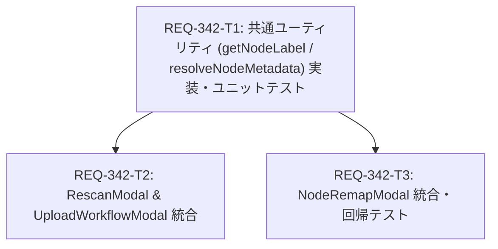

# Implementation Plan: REQ-342 ワークフロー登録・リマップ候補ノードラベルのタイトル/クラス併記統一

## 1. Overview & Objectives (概要と目的)
本実装計画は、`REQ-342` に基づき、ワークフロー登録時（`UploadWorkflowModal`）、ワークフローリマッピング時（`RescanModal`）、およびデータセットスタジオのノードリマッピング時（`NodeRemapModal`）におけるドロップダウン候補ノード表示の不整合・情報欠落（IDのみ表示、空の `[]`、マスタロール名の誤表示など）を解消するためのフロントエンド改修を定義します。

- ワークフローJSON（API形式辞書 / UIグラフ配列）からノードのカスタムタイトルおよびクラス名を安全に抽出・解決する共通ユーティリティ関数 `resolveNodeMetadata`, `getNodeLabel` の新設
- フォーマットの統一: `${id} - [${title}] (${classType})`（未設定時は `${id} - [${title}]`、`${id} - (${classType})`、`${id}` へフォールバック）
- 3箇所のモーダルコンポーネントにおける重複・不完全なローカルロジックの排除と共通ユーティリティへの統合

---

## Proposed Changes

### Subsystem: frontend

#### [LOCAL NEW] [frontend/src/utils/workflowNodeUtils.ts](file:///c:/Users/audih/ws/comfy-create-helper2/frontend/src/utils/workflowNodeUtils.ts)
- `resolveNodeMetadata(id, workflowJson)`: API形式 `workflowJson[id]` および UIグラフ形式 `workflowJson.nodes` から `title` と `classType` を安全に抽出
- `getNodeLabel(id, workflowJson)`: 統一ラベル `${id} - [${title}] (${classType})` を生成

#### [LOCAL NEW] [frontend/src/utils/__tests__/workflowNodeUtils.test.ts](file:///c:/Users/audih/ws/comfy-create-helper2/frontend/src/utils/__tests__/workflowNodeUtils.test.ts)
- TC-UTIL-01〜TC-UTIL-06、TC-RED-01〜02（null/undefined安全性、辞書/配列対応、フォールバック等）を網羅する単体テスト

#### [LOCAL MODIFY] [frontend/src/components/RescanModal.tsx](file:///c:/Users/audih/ws/comfy-create-helper2/frontend/src/components/RescanModal.tsx)
- 最初のマッチノードしか拾えずクラス名ではなくマスタロール名を表示していた `nodeTitleMap` を廃止
- 候補ノード `<option>` 表示に `getNodeLabel(id, workflowJson)` を適用

#### [LOCAL MODIFY] [frontend/src/components/UploadWorkflowModal.tsx](file:///c:/Users/audih/ws/comfy-create-helper2/frontend/src/components/UploadWorkflowModal.tsx)
- `_meta.title` のみを参照して空の `[]` を生んでいたローカル関数 `getNodeLabel` を共通関数に差し替え

#### [LOCAL MODIFY] [frontend/src/pages/DatasetStudioPage/components/NodeRemapModal.tsx](file:///c:/Users/audih/ws/comfy-create-helper2/frontend/src/pages/DatasetStudioPage/components/NodeRemapModal.tsx)
- ローカルの `getNodeLabel` を共通関数に差し替え（外部互換性のための re-export 含む）
- パラメータマッピング側のセレクトボックスでも `getNodeLabel(id, workflow.json_body)` を適用して表示を統一

#### [LOCAL MODIFY] [frontend/src/pages/DatasetStudioPage/components/__tests__/NodeRemapModal.test.tsx](file:///c:/Users/audih/ws/comfy-create-helper2/frontend/src/pages/DatasetStudioPage/components/__tests__/NodeRemapModal.test.tsx)
- 候補ノードのラベル表示が統一フォーマット `${id} - [${title}] (${classType})` に合致することを検証するコンポーネントテストを追加

---

## 3. Task Dependency & Parallel Execution Plan (DAG)

- **並列実行可能性**:
  - `REQ-342-T1` が基盤ユーティリティであり先行必須です。
  - `REQ-342-T2`（モーダル登録・再スキャン側）と `REQ-342-T3`（DatasetStudio側）は変更ファイルが完全に分離されているため、T1完了後は並列実行可能です。

---

## 4. Verification & Baseline Strategy (検証戦略)

- **Gate 1: Static Typecheck**:
  - `cd frontend; npm run typecheck`（型エラー0件）
- **Gate 2: Unit / Component Test Discovery**:
  - `cd frontend; npx vitest run src/utils/__tests__/workflowNodeUtils.test.ts`
  - `cd frontend; npx vitest run src/pages/DatasetStudioPage/components/__tests__/NodeRemapModal.test.tsx`
- **Gate 3: Baseline & Red Teaming**:
  - フルテストスイート: `cd frontend; npm test`（リグレッション0件）
  - 境界値・堅牢性検証: `null`/`undefined`/空オブジェクト、数値文字列ID（`"10"` vs `10`）、UIグラフ形式・API辞書形式の混在ケース

---

## Trade-off Disclosure

1. **API形式（辞書）とUIグラフ形式（配列）の双方自動判定**:
   - `workflowJson[id]` をまず O(1) で評価し、存在しない場合のみ `Array.isArray(workflowJson.nodes)` で O(N) 走査します。大規模なComfyUIワークフロー（100〜200ノード）でも探索時間は1ミリ秒未満であり、レンダリングパフォーマンスへの悪影響はありません。
2. **タイトル未設定時のクラス名フォールバック表示**:
   - ユーザーがノードにカスタムタイトルを設定していない場合、`${id} - [KSampler] (KSampler)` のようにタイトル部にもクラス名が補完されます。空の `[]` が表示される不自然さを防ぎ、ノードの役割を確実に把握できるようにするための意図的な設計判断です。
3. **ワークフローJSON未ロード時のグレースフルフォールバック**:
   - リマッピング初期化前など、`workflowJson` がまだロードされていないタイミングでは安全にID番号のみ（`${id}`）を表示し、コンポーネントが例外をスローしてクラッシュする事態を防止します。
