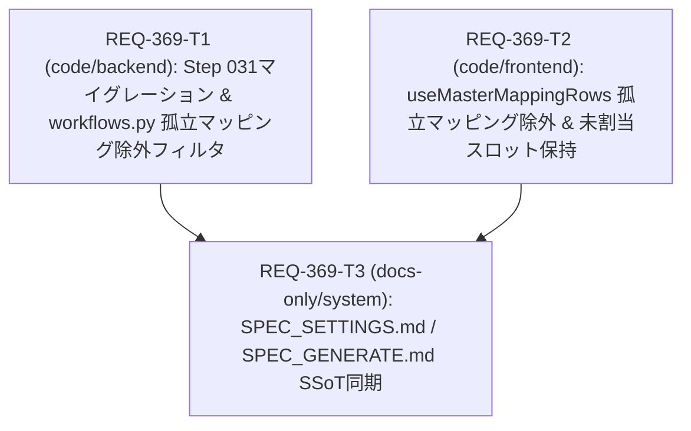

# Implementation Plan: REQ-369 ノードリマッピング（RescanModal）実行時に削除済み旧マスタの孤立マッピングおよび未割当ステージが自動保存されマッピングエラーが多発する不具合の修正

V2 マッピングマスタ移行（`REQ-336`）後に削除された旧ステージ別マスタ（`master_id: 33〜62`）の孤立マッピングがリマッピング保存時に再送信される問題、および既存ワークフローの再スキャン時に未割当のステージスロット（`Rough` / `Detail` / `FaceDetailer` 等）へスキャン結果が自動入力・保存される問題を、フロントエンド・バックエンド・DBマイグレーションの3層で解決します。

- インシデントレポート: [`docs/incident_report.md`](file:///c:/Users/audih/ws/comfy-create-helper2/docs/incident_report.md)
- PBI: [`docs/backlog/pbi/active/REQ-369.md`](file:///c:/Users/audih/ws/comfy-create-helper2/docs/backlog/pbi/active/REQ-369.md)
- 設計書: [`docs/design/REQ-369.md`](file:///c:/Users/audih/ws/comfy-create-helper2/docs/design/REQ-369.md)
- テスト計画: [`docs/design/REQ-369-test-plan.md`](file:///c:/Users/audih/ws/comfy-create-helper2/docs/design/REQ-369-test-plan.md)
- Task Cards:
  - [`docs/backlog/task/active/REQ-369-T1.md`](file:///c:/Users/audih/ws/comfy-create-helper2/docs/backlog/task/active/REQ-369-T1.md)
  - [`docs/backlog/task/active/REQ-369-T2.md`](file:///c:/Users/audih/ws/comfy-create-helper2/docs/backlog/task/active/REQ-369-T2.md)
  - [`docs/backlog/task/active/REQ-369-T3.md`](file:///c:/Users/audih/ws/comfy-create-helper2/docs/backlog/task/active/REQ-369-T3.md)

## Proposed Changes

### Backend: DBマイグレーション & 保存時サニタイズ (`REQ-369-T1`)
#### [MODIFY] [`backend/app/migrations/steps.py`](file:///c:/Users/audih/ws/comfy-create-helper2/backend/app/migrations/steps.py)
- `step_031_cleanup_orphaned_workflow_mappings` を追加し、`ALL_MIGRATION_STEPS` に `MigrationStep("031", "cleanup_orphaned_workflow_mappings", ...)` を登録。
- `workflow_mappings` のうち、`master_id NOT IN (SELECT id FROM mapping_masters)` または `variant_id IS NOT NULL AND NOT EXISTS (SELECT 1 FROM mapping_variants mv WHERE mv.id = workflow_mappings.variant_id AND mv.master_id = workflow_mappings.master_id)` に該当する孤立レコード（本番DBで984件）を冪等に削除（`AC-5`）。

#### [MODIFY] [`backend/app/routers/workflows.py`](file:///c:/Users/audih/ws/comfy-create-helper2/backend/app/routers/workflows.py)
- `_load_valid_mapping_refs(db)` および `_is_valid_mapping_ref(...)` を追加し、`create_workflow` / `update_workflow` / `copy_workflow` / `rollback_workflow` の全書込経路で実在しない `master_id` または不整合 `variant_id` を保存対象から除外（`AC-4`）。

#### [MODIFY] [`backend/tests/integration/api/test_workflows.py`](file:///c:/Users/audih/ws/comfy-create-helper2/backend/tests/integration/api/test_workflows.py)
- `[REQ-369/AC-4]` 保存・更新・コピー・ロールバック時の孤立マッピング除外テストを追加。
- `[REQ-369/AC-5]` `step_031_cleanup_orphaned_workflow_mappings` の孤立レコード削除・冪等性テストを追加。

### Frontend: リマッピングフック修正 & テスト (`REQ-369-T2`)
#### [MODIFY] [`frontend/src/hooks/useMasterMappingRows.ts`](file:///c:/Users/audih/ws/comfy-create-helper2/frontend/src/hooks/useMasterMappingRows.ts)
- `isValidSavedMapping(mapping, allDefinitions)` を導入し、`allDefinitions`（有効・無効すべての実在マスタ/バリアント定義）に存在するマッピングのみを `storedMappings.current`・`savedMappings`・`getMappings` 保持ループの対象とすることで、削除済みマスタ（`master_id: 33〜62`, `999`）や存在しない `variant_id` の孤立マッピングを除外しつつ、実在する無効バリアント/無効マスタのマッピングは保持（`AC-1`）。
- `initFromScan` において `savedMappings.length > 0`（既存ワークフローのリマッピング）の場合は、未割当スロットに `scanDefaults` を自動セットせず `''`（未割当）のまま維持し、ドロップダウン候補（`candidates` / `recommendedNodeIds`）のみを提供する（`AC-2`）。
- `savedMappings.length === 0`（新規ワークフロー登録 `UploadWorkflowModal` 等）の場合は従来通り `scanDefaults` で初期値を自動セットする（`AC-3`）。

#### [MODIFY] [`frontend/src/hooks/__tests__/useMasterMappingRows.test.ts`](file:///c:/Users/audih/ws/comfy-create-helper2/frontend/src/hooks/__tests__/useMasterMappingRows.test.ts) & [`frontend/src/components/__tests__/WorkflowModalMultiStage.test.tsx`](file:///c:/Users/audih/ws/comfy-create-helper2/frontend/src/components/__tests__/WorkflowModalMultiStage.test.tsx)
- `[REQ-369/AC-1]`, `[REQ-369/AC-2]`, `[REQ-369/AC-3]` のユニットテスト・モーダル統合テストを追加し、旧前提のテストケース2件を新契約に合わせて更新。

### Documents: SSoT 仕様書同期 (`REQ-369-T3`)
#### [MODIFY] [`docs/specs/SPEC_SETTINGS.md`](file:///c:/Users/audih/ws/comfy-create-helper2/docs/specs/SPEC_SETTINGS.md) & [`docs/specs/SPEC_GENERATE.md`](file:///c:/Users/audih/ws/comfy-create-helper2/docs/specs/SPEC_GENERATE.md)
- §4-1-1（`SPEC_SETTINGS.md`）および §2-5（`SPEC_GENERATE.md`）に孤立マッピング除外・既存ワークフロー未割当スロット保持・Step 031 浄化の契約を追記。

## Task DAG

- `REQ-369-T1` と `REQ-369-T2` は所有ファイルが完全に分離されており並列実行可能。その後 `REQ-369-T3` で SSoT ドキュメントを同期する。

## Trade-off Disclosure（技術的トレードオフ・制約・代替案）

| 論点 | 採用方針 | 代替案と却下理由 |
|---|---|---|
| バックエンド API での孤立 `master_id` / `variant_id` の扱い | **サイレント・フィルタ（サニタイズ除外）**: 有効なマッピングのみを永続化し、孤立行を除外して `200 OK` / `201 Created` を返す | **422 Unprocessable Entity で拒否**: Generate 画面の `MappingErrorPanel.handleUpdateMapping` は `workflow.mappings` 配列をコピーして 1 件ずつ修正・`PUT` するため、複数エラーがある状態で 1 件目を直した際に他の孤立行が原因で 422 失敗し、UI から修復不能になる。また OpenAPI スナップショットの不変性も維持できるためサニタイズ除外を採用。 |
| 既存ワークフローのリマッピング時の未割当スロット初期値 | `savedMappings.length > 0` の場合は未割当スロットを `''`（未割当）にし、候補リスト（`recommendedNodeIds` / `candidates`）のみ提供する | スキャン一致ノードを自動入力する: マルチステージ定義（Rough/Detail/FaceDetailer 等）がある環境では、ユーザーが意図しないノードが全ステージへ一括自動割当・保存され、ワークフロー設定を破壊するため却下。 |

## Verification Plan（3-Gate）
- **Gate 1 (Static / Typecheck)**:
  - `backend\.venv\Scripts\python -m ruff check backend`
  - `npm --prefix frontend run typecheck`
- **Gate 2 (Full Test Suite)**:
  - `backend\.venv\Scripts\python -m pytest`
  - `npx --prefix frontend vitest run`
- **Gate 3 (Targeted Scenarios & QA Audit)**:
  - `backend\.venv\Scripts\python -m pytest backend/tests/integration/api/test_workflows.py -k "REQ_369 or orphan or step_031"`
  - `npx --prefix frontend vitest run src/hooks/__tests__/useMasterMappingRows.test.ts src/components/__tests__/WorkflowModalMultiStage.test.tsx -t "REQ-369"`

