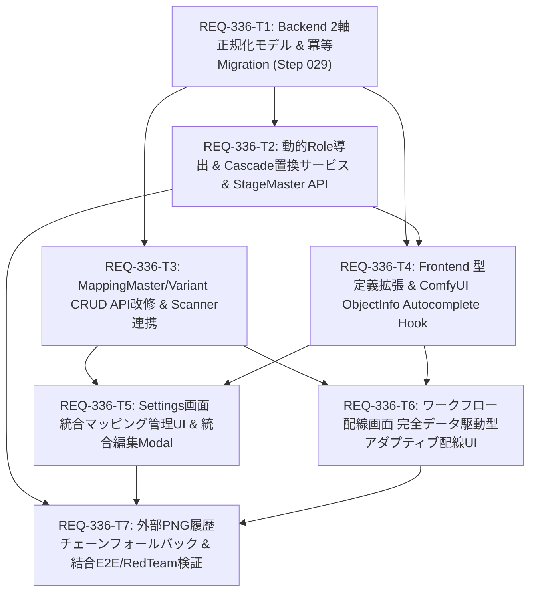

# REQ-336 実装計画 (Prompt Surgeon ワークフローマッピング新アーキテクチャ統合)

## Architectural Overview & Objective
本PBIは、ワークフローマッピングの肥大化および多段階サンプラ（3段以上）やリージョン分割等の高度なComfyUIワークフロー適応不全を解決するため、「セマンティックロール（普遍的親定義）× ステージ（ユーザー拡張可能な適用工程）」の2軸直交正規化を行い、交差エンティティ（バリアント）による動的Role導出と完全データ駆動型アダプティブ配線UIを導入します。

---

## Task Dependency & DAG Visualization

### 並列実行可能性 (Parallel Execution Strategy)
- **Phase 1 (Foundation)**: `REQ-336-T1` (単独実行・スキーマ基礎)
- **Phase 2 (Core Services & Client Foundation - 並列実行可能)**:
  - `REQ-336-T2` (Backend Cascade & Stage API)
  - `REQ-336-T3` (Backend Master/Variant API & Scanner)
  - `REQ-336-T4` (Frontend Types & ObjectInfo Hook)
- **Phase 3 (UI Implementation - 並列実行可能)**:
  - `REQ-336-T5` (Settings 統合マッピング管理画面)
  - `REQ-336-T6` (WorkflowConnection アダプティブ配線画面)
- **Phase 4 (Integration & Gate 3 Baseline)**:
  - `REQ-336-T7` (外部PNG履歴フォールバック・全AC照合・Red Teaming)

---

## Proposed Changes & File Impact

#### [LOCAL MODIFY] [backend/app/models.py](file:///c:/Users/audih/ws/comfy-create-helper2/backend/app/models.py)
- `MappingGroupMaster`, `StageMaster`, `MappingVariant` モデルの追加。
- `MappingMaster` への `group_id`, `base_key`, `base_title_patterns` カラムおよびリレーションシップの追加。
- `WorkflowMapping` への `variant_id` カラム追加。

#### [LOCAL MODIFY] [backend/app/migrations/steps.py](file:///c:/Users/audih/ws/comfy-create-helper2/backend/app/migrations/steps.py)
- `step_029_workflow_mapping_v2_normalization` の追加。
- 既存 `mapping_master` からの冪等かつ安全なデータ分解・移行とロールバック保護。

#### [LOCAL MODIFY] [backend/app/seeder.py](file:///c:/Users/audih/ws/comfy-create-helper2/backend/app/seeder.py)
- 初期シード時のグループ、ステージ、親マスタ、バリアントの投入処理改修。

#### [LOCAL NEW] [backend/app/services/mapping_service.py](file:///c:/Users/audih/ws/comfy-create-helper2/backend/app/services/mapping_service.py)
- Cascade Rename プレビュー算出および排他ロック下トランザクション一括置換。
- 3重削除ガードロジックおよび旧接尾辞履歴（上限10件）管理。

#### [LOCAL NEW] [backend/app/schemas/mapping.py](file:///c:/Users/audih/ws/comfy-create-helper2/backend/app/schemas/mapping.py)
- Group, Stage, Master, Variant, CascadePreview, CascadeRenameRequest の Pydantic スキーマ定義。

#### [LOCAL NEW] [backend/app/routers/stage_masters.py](file:///c:/Users/audih/ws/comfy-create-helper2/backend/app/routers/stage_masters.py)
- StageMaster CRUD、Cascade Preview / Rename エンドポイント。

#### [LOCAL NEW] [backend/app/routers/mapping_groups.py](file:///c:/Users/audih/ws/comfy-create-helper2/backend/app/routers/mapping_groups.py)
- MappingGroupMaster CRUD エンドポイント。

#### [LOCAL MODIFY] [backend/app/routers/mapping_masters.py](file:///c:/Users/audih/ws/comfy-create-helper2/backend/app/routers/mapping_masters.py)
- 親マスターとバリアント一覧を統合管理するエンドポイント改修（後方互換性維持）。

#### [LOCAL MODIFY] [backend/app/services/workflow_scanner.py](file:///c:/Users/audih/ws/comfy-create-helper2/backend/app/services/workflow_scanner.py)
- バリアント単位スキャンおよび StageMaster 検索キーワード合致判定の実装。

#### [LOCAL MODIFY] [frontend/src/api/types.ts](file:///c:/Users/audih/ws/comfy-create-helper2/frontend/src/api/types.ts)
- `MappingGroupMaster`, `StageMaster`, `MappingMasterV2`, `MappingVariant`, `CascadePreviewResponse` 等の TypeScript 型定義追加。

#### [LOCAL NEW] [frontend/src/hooks/useComfyNodeTypes.ts](file:///c:/Users/audih/ws/comfy-create-helper2/frontend/src/hooks/useComfyNodeTypes.ts)
- `/api/comfy/object_info` キャッシュ連動のインクリメンタル・オートコンプリート候補抽出フック。

#### [LOCAL MODIFY] [frontend/src/pages/SettingsPage/components/MappingMasterSection.tsx](file:///c:/Users/audih/ws/comfy-create-helper2/frontend/src/pages/SettingsPage/components/MappingMasterSection.tsx)
- 大カテゴリタブ切り替え、バリアント同居テーブル行表示。

#### [LOCAL NEW] [frontend/src/components/MappingMasterEditModal.tsx](file:///c:/Users/audih/ws/comfy-create-helper2/frontend/src/components/MappingMasterEditModal.tsx)
- 親共通設定・チップ入力（Class Types / 検索パターン）・バリアント統合編集モーダル。

#### [LOCAL NEW] [frontend/src/components/StageManagerModal.tsx](file:///c:/Users/audih/ws/comfy-create-helper2/frontend/src/components/StageManagerModal.tsx)
- ステージ追加・編集・Cascadeプレビュー確認ダイアログ・3重削除ガード。

#### [LOCAL MODIFY] [frontend/src/pages/SettingsPage/components/WorkflowConnectionSection.tsx](file:///c:/Users/audih/ws/comfy-create-helper2/frontend/src/pages/SettingsPage/components/WorkflowConnectionSection.tsx)
- アダプティブ配線UIの統合。

#### [LOCAL NEW] [frontend/src/components/AdaptiveWorkflowWiring.tsx](file:///c:/Users/audih/ws/comfy-create-helper2/frontend/src/components/AdaptiveWorkflowWiring.tsx)
- アクティブステージ動的タブ展開、合致ノード0件ステージの自動非表示UI。

#### [LOCAL NEW] [frontend/src/utils/workflowAdaptiveStageDetector.ts](file:///c:/Users/audih/ws/comfy-create-helper2/frontend/src/utils/workflowAdaptiveStageDetector.ts)
- ワークフローメタデータと StageMaster キーワード照合によるアクティブステージ判定。

#### [LOCAL MODIFY] [frontend/src/utils/workflowParamInjector.ts](file:///c:/Users/audih/ws/comfy-create-helper2/frontend/src/utils/workflowParamInjector.ts)
- 外部PNG画像メタデータの `previous_suffixes` 履歴チェーンおよび `base_key` フォールバック解決。

#### [LOCAL NEW] [backend/tests/test_req336_e2e_integration.py](file:///c:/Users/audih/ws/comfy-create-helper2/backend/tests/test_req336_e2e_integration.py)
- 全ACライフサイクルおよび Red Teaming 4シナリオの結合テスト。

---

## Trade-off Disclosure (技術的トレードオフの開示)

1. **DB内完全置換 (Cascade Rename) vs エイリアス永続保持**:
   - **検討した代替案**: ステージ接尾辞変更時に旧Role名をエイリアステーブルに永久保持し、実行時に動的リダイレクトする手法。
   - **採用案と理由**: エイリアス保持はコード内に無限のフォールバック分岐と技術的負債を残すため、DB内データ（プリセット・スナップショット・バリアント）は単一トランザクションで100%最新Role名に一括置換する方針を採用。これにより実行時参照が常に $O(1)$ で完了し、シンプルなコードベースを維持できる。
   - **トレードオフ**: 接尾辞変更時にトランザクション排他ロックを伴うため、大量のプリセットが存在する場合は数ミリ秒のロックが発生する。事前プレビューダイアログの提示と確認トグルにより安全性を担保する。

2. **外部PNG画像の履歴チェーン (上限10件) vs 無制限履歴**:
   - **検討した代替案**: 過去の旧接尾辞を無制限に追跡する履歴テーブルの構築。
   - **採用案と理由**: 外部PNG画像はDB外に存在するため一括置換できないが、実運用上タイポ修正やサフィックス変更が1つのステージで10回を超えることは極めて稀。`previous_suffixes` JSON配列に上限10件で直近履歴を収め、上限超過時は最古の履歴を切り捨て、`base_key` 分割によるグレイスフル解決へフォールバックさせる。
   - **トレードオフ**: 10世代以上前の超長期画像でかつ非標準サフィックスの場合、`base_key` 解決となりステージ特有のパラメータ復元がデフォルト値になる可能性があるが、DB肥大化と探索オーバーヘッドを確実に防ぐ。

3. **動的Role導出 (Computed Property) vs DBカラム物理保存**:
   - **検討した代替案**: `mapping_variants` に結合後のRole名をカラムとして保存し、ステージ変更時に全バリアント行を UPDATE する手法。
   - **採用案と理由**: 単方向プロパティ導出（`base_key + suffix` または `custom_role_override`）を採用。`workflow_mappings` は数値の `variant_id` で結合されているため、Role名変更に伴う配線切断が物理的に発生しない。
   - **トレードオフ**: SQLクエリ上で直接 Role 文字列によるフィルタリングを行う際は JOIN が必要となるが、ORMモデルのリレーションおよびインデックスによりパフォーマンス影響は皆無である。

---

## Acceptance Criteria Mapping

| AC ID | 対象タスク | 検証手法 |
|---|---|---|
| AC-1 | REQ-336-T1, T7 | `test_req336_models_migration.py` による2軸正規化・既存データ整合性・冪等性テスト |
| AC-2 | REQ-336-T5 | `MappingMasterSection.req336.test.tsx` による大カテゴリタブ絞り込み・バリアント同居行テスト |
| AC-3 | REQ-336-T5 | `MappingMasterSection.req336.test.tsx` によるチップ入力・全バリアント一元反映・プレビューテスト |
| AC-4 | REQ-336-T1, T2 | `test_req336_models_migration.py` による `computed_role` 単方向導出および一意性テスト |
| AC-5 | REQ-336-T2, T5 | `test_req336_cascade_service.py` によるプレビュー確認およびトランザクション一括置換テスト |
| AC-6 | REQ-336-T2, T3 | `test_req336_stage_api.py` によるシステム既定・参照中削除ブロックおよび非活性化連動テスト |
| AC-7 | REQ-336-T6 | `WorkflowAdaptiveStaging.test.tsx` による未知ステージ追加とワークフロー自動マッチングテスト |
| AC-8 | REQ-336-T6 | `WorkflowAdaptiveStaging.test.tsx` による合致0件ステージ自動非表示・空行ゼロテスト |
| AC-9 | REQ-336-T7 | `test_req336_e2e_integration.py` による外部PNG履歴チェーン解決およびグレイスフル解決テスト |
| AC-10 | REQ-336-T4, T5 | `useComfyNodeTypes.test.ts` による `/api/comfy/object_info` オートコンプリートおよび非同期手入力テスト |

