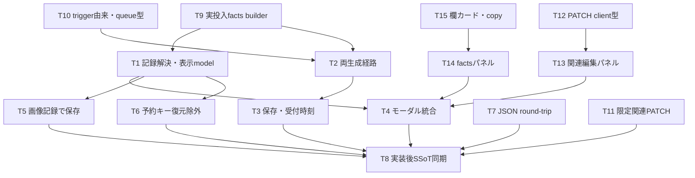
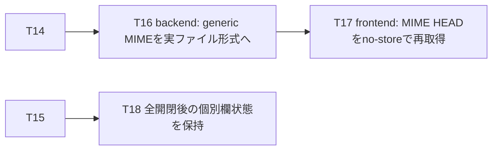

# Implementation Plan - REQ-316: 生成メタ情報の全項目表示とタグ関連編集

## Review Status
**改訂設計・テスト計画・T1〜T15は2026-10-04にユーザー承認済み。T1〜T18、T8仕様同期、全ACの検証を完了し、Phase 4 closureへ移行。** ユーザー追加範囲（参考UI構成、非promptメタ情報、generic/LoRA trigger関連編集）と実seed捕捉を含む。旧「API/backend変更なし」「copy未依頼」は撤回済み。
未保存プレビューの関連は読取専用、保存済みSnapshotで追加/削除/保存/キャンセル。生成factsは編集で変えない。保持上限local200/server1000を維持。
Gate 1: frontend typecheck exit 0、backend mypy 71 files / 0 errors。Gate 2: frontend 106 files / 1063 tests PASS（[log](logs/REQ-316-frontend-full-tests-final.log)）、backend 413 tests PASS（2 warnings、[log](logs/REQ-316-backend-full-tests-mime.log)）。frontend build exit 0、最新dist assetsを確認。
Gate 3: desktop 1280×900/mobile 390×844、全開閉後の欄単位状態、2364書記素prompt末尾、寸法/比率、JSON値、LoRA強度、keyboard、tag draft cancel/saveを確認。T16/T17後に同一browserでimage/webpを確認。実ComfyUIは6画像の5欄・actual seed一致を確認。ユーザー報告で実clipboardの手動確認も完了（AC-24 PASS）。過去のCUA virtual clipboard readback制約は履歴として保持し、OS byte比較やseedコピー個別確認は主張しない。詳細は[walkthrough](docs/design/REQ-316-walkthrough.md)。
QA test-plan auditは2回とも `REQUIRES MODIFICATION BEFORE EXECUTION`。AC/INT測定、出力、timeoutの明確化を追記した。追加の再監査は行っておらず、PASS判定もない（[triage](docs/design/REQ-316-qa-audit-triage.md)、[logs](docs/design/REQ-316-qa-audit-execution.log) / [rerun](docs/design/REQ-316-qa-audit-rerun.log)）。拡張設計BA監査もINCONCLUSIVE（[記録](docs/design/REQ-316-ba-audit.md)）。
実装進捗: T1〜T18 done。T4をT4a/T4b/T4c、Gate 3補正をT16/T17/T18へ内部分割して局所検証。T18後のfrontend suite 106 files/1063 tests、buildもPASS。DAGに従いデータ/生成系とUIを並行し、UI担当枠が空いた後に独立タスクT11を実施（T11に先行依存なし）。ユーザー報告で実clipboard手動確認、監査追加プロセス指摘の許容を確認。監査原判定は維持し、全AC PASS根拠でarchive/commitを実施する。
[設計](docs/design/REQ-316.md)、[テスト計画](docs/design/REQ-316-test-plan.md)、[改訂要件 AC-1〜24](docs/backlog/pbi/archive/REQ-316.md)。
## Proposed Changes
- 全textarea＋全その他mappingと未分類paramsを、記録された名前/順序/JSON全文で表示。false/0/空値/配列/辞書も保持。
- inject後・bypass後の実投入graphからseed/非prompt/LoRA別強度を捕捉。bypass前promptはバイパス状態を添え、実使用と混同しない。
- 生成時workflow名・欄・asset由来を固定。キュー受付/DB記録/画像保存時刻は意味別表示、完了時刻は未記録。currentマスター値で履歴を補完しない。
- 参考構造のヘッダー・タブ・欄カード・全開閉・copy・基本/その他・LoRA/関連を採用。実画像寸法/正確比率、Unicode書記素数、動的件数、copy拒否通知、responsive/keyboard対応。参考の固定数/フォント/mock制御は製品契約にしない。
- 2種類の関連はtyped PATCHで独立永続化。TagSetのrole、LoRAのrole/各strength、生成record、album等の未編集値を保持。DB列追加なし、APIは後方互換拡張。
- current fallbackを除去しSnapshot.paramsを正本にする。200/1000件の削除規則を維持。

## Task Decomposition
|ID|所有ファイル|依存|見積り変更行|
|---|---|---|---|
|[T1 記録の検証・解決・表示モデル](docs/backlog/task/archive/REQ-316-T1.md)|`frontend/src/utils/promptRecord.ts` `frontend/src/utils/__tests__/promptRecord.test.ts`|T9|290以下|
|[T2 両生成経路で実投入factsを固定](docs/backlog/task/archive/REQ-316-T2.md)|`frontend/src/pages/GeneratePage/hooks/useGenerateAction.ts` `frontend/src/pages/GeneratePage/hooks/__tests__/useGenerateAction.test.ts`|T9, T10|230以下|
|[T3 独立二重保存とキュー受付時刻](docs/backlog/task/archive/REQ-316-T3.md)|`frontend/src/store/slices/jobQueueSlice.ts` `frontend/src/store/__tests__/slices/jobQueueSlice.test.ts`|T2|190以下|
|[T4 プレビューへ情報/編集パネルを統合（集約）](docs/backlog/task/archive/REQ-316-T4.md)|`frontend/src/components/HistoryModalPreview.tsx` `frontend/src/components/__tests__/HistoryModalPreview.test.tsx`|T1, T13, T14|段階分割|
|[T4a 旧関連編集UIの機械撤去](docs/backlog/task/archive/REQ-316-T4a.md)|`frontend/src/components/HistoryModalPreview.tsx`|T1, T13, T14|165以下|
|[T4b 旧情報表示と推測抽出の機械撤去](docs/backlog/task/archive/REQ-316-T4b.md)|`frontend/src/components/HistoryModalPreview.tsx`|T4a|195以下|
|[T4c 新パネル接続とプレビュー統合検証](docs/backlog/task/archive/REQ-316-T4c.md)|`frontend/src/components/HistoryModalPreview.tsx` `frontend/src/components/__tests__/HistoryModalPreview.test.tsx`|T4b|150以下|
|[T5 画像factsをSnapshotへ独立保存](docs/backlog/task/archive/REQ-316-T5.md)|`frontend/src/pages/GeneratePage/hooks/useSnapshotActions.ts` `frontend/src/pages/GeneratePage/hooks/__tests__/useSnapshotActions.test.ts`|T1|240以下|
|[T6 記録/関連キーを入力復元から除外](docs/backlog/task/archive/REQ-316-T6.md)|`frontend/src/pages/GeneratePage/hooks/useWorkflowParams.ts` `frontend/src/pages/GeneratePage/hooks/__tests__/useWorkflowParams.test.ts`|T1|90以下|
|[T7 生成factsのAPI round-trip検証](docs/backlog/task/archive/REQ-316-T7.md)|`backend/tests/test_prompt_metadata.py` `backend/tests/test_snapshots_req316_metadata.py`|なし|190以下|
|[T8 実装証拠で正本仕様へ同期](docs/backlog/task/archive/REQ-316-T8.md)|`docs/specs/SPEC_GENERATE.md` `docs/specs/SPEC_HISTORY.md`|T3, T4, T5, T6, T7, T11|100以下|
|[T9 生成record型と実投入値builder](docs/backlog/task/archive/REQ-316-T9.md)|`frontend/src/utils/generationRecord.ts` `frontend/src/utils/__tests__/generationRecord.test.ts`|なし|290以下|
|[T10 trigger選択由来とqueue型を捕捉](docs/backlog/task/archive/REQ-316-T10.md)|`frontend/src/store/types.ts` `frontend/src/pages/GeneratePage/hooks/useAssetSelectionState.ts` `frontend/src/pages/GeneratePage/hooks/__tests__/useAssetSelectionState.test.ts`|なし|220以下|
|[T11 二種類のタグ関連を限定PATCH](docs/backlog/task/archive/REQ-316-T11.md)|`backend/app/schemas/snapshot.py` `backend/app/services/snapshot_service.py` `backend/tests/test_snapshot_associations_req316.py`|なし|300以下|
|[T12 タグ関連PATCHのクライアント型](docs/backlog/task/archive/REQ-316-T12.md)|`frontend/src/api/types.ts` `frontend/src/api/client.ts` `frontend/src/api/__tests__/snapshotAssociations.test.ts`|なし|140以下|
|[T13 現在のタグ関連をdraftで編集](docs/backlog/task/archive/REQ-316-T13.md)|`frontend/src/components/SnapshotTagAssociationsPanel.tsx` `frontend/src/components/__tests__/SnapshotTagAssociationsPanel.test.tsx`|T12|290以下|
|[T14 生成facts・パラメータ・ヘッダー表示](docs/backlog/task/archive/REQ-316-T14.md)|`frontend/src/components/GenerationMetadataPanel.tsx` `frontend/src/components/__tests__/GenerationMetadataPanel.test.tsx`|T15|300以下|
|[T15 全プロンプト欄カード・書記素数・コピー](docs/backlog/task/archive/REQ-316-T15.md)|`frontend/src/components/GenerationPromptFields.tsx` `frontend/src/components/__tests__/GenerationPromptFields.test.tsx`|なし|290以下|
|[T16 保存画像HTTP MIMEを実ファイルで確定](docs/backlog/task/archive/REQ-316-T16.md)|`backend/app/main.py` `backend/tests/test_snapshot_image_mime_req316.py`|T14|100以下（QA補正）|
|[T17 保存画像MIME取得のHTTP cache回避](docs/backlog/task/archive/REQ-316-T17.md)|`frontend/src/components/GenerationMetadataPanel.tsx` `frontend/src/components/__tests__/GenerationMetadataPanel.test.tsx`|T16|10以下（QA補正）|
|[T18 個別欄の開閉状態を全開閉後も保持](docs/backlog/task/archive/REQ-316-T18.md)|`frontend/src/components/GenerationPromptFields.tsx` `frontend/src/components/__tests__/GenerationPromptFields.test.tsx`|T15|60以下（QA補正）|
承認済みT1〜T15の主要Task CardとT4a/T4b/T4cの実行段階カードは本文300行未満、所有3ファイル以下・実装と局所testを含め各300変更行以下。T4a/b/cはT4の内部作業分割で、AC/所有範囲/外部DAGを変えず、最終T4cで統合受入を確認した。

## Dependency DAG

最大4層。T9/T10/T11/T12/T15/T7から開始可。T14はT15の欄propsのみimportし、T1/T9をimportしない構造型の表示propsを宣言する。T4で表示modelへ接続する。T15もT1/T9をimportしないので隠れた未生成type依存を作らない。T11とT13の統合は両方完了後のQAで確認。

## Post-E2E QA correction tasks
本改訂DAGの全Task完了後、Windows環境の保存画像HTTP MIMEに汎用値が返ることと、修正前値をブラウザーcacheが保持することをGate 3で検出。承認済みAC-15の達成に限った追加修正を分割した。

T16/T17/T18は承認済みAC-14/15の達成に限定したQA補正。各カードの局所/full/frontend/browser証拠をwalkthroughへ記録する。

## Verification Plan
各カードに局所typecheck/test command。QAは全欄/seed/全JSON/時刻意味/旧記録/保存後cache削除/現在関連編集/ロール強度不変/寸法/count/clipboard/keyboard/mobileを検証。
実ComfyUI/E2Eが利用不能なら該当結果はINCONCLUSIVE。設計監査は実装検証の代替にしない。

## Trade-off Disclosure
予約JSONで既存params輸送を維持する。生成factsとmutable関連は別キー、PATCHは現DBの関連キーだけを更新しfactsを保持。専用trigger中間表/migrationは今回は追加しない。
全文コピーで容量は増える。local保存例外はserver保存を妨げず成功prompt IDを維持。local200/server1000件保持とserver非同期方式は従来どおり。保存済み画像は独立記録、未保存無期限保持は保証しない。
旧actual seed/trigger ID/欄名/workflow名/完了時間は未記録。graph参照から実行後のresolved値を逆算しない。current album/asset masterは現在関連としてのみ表示。関連の同時編集は最後の成功保存が優先。

## Verification / Closure Gate
人間は2026-10-04に改訂設計・テスト計画・T1〜T15実装を承認済み。T1〜T18とT8仕様同期、Gate 1/2/build、全ACの記録済み検証はPASS。ユーザーは手動clipboard確認と監査追加プロセス指摘の許容を明示承認。監査原判定（2件REQUIRES MODIFICATION/INCONCLUSIVE）は保持したままPhase 4を実施する。詳細は[walkthrough](docs/design/REQ-316-walkthrough.md)と[監査記録](docs/design/REQ-316-ba-audit.md)。

## REQ-314 Design Review Reference
REQ-314は設計レビュー待ち。既存REQ-316計画は上記を維持し、REQ-314の独立計画を [REQ-314 implementation plan](docs/design/REQ-314-implementation_plan.md) に配置する。設計・テスト計画・14枚Task Card、D1（6/7 prompt）/D2（接続URL編集）の人間決定、BA監査とGPU解放証拠を同計画から参照する。
