# Implementation Plan: REQ-319 Prompt Surgeon: LoRA Studio（素材直交生成・キュレーション・ローカル学習・4軸ストレステスト評価）統合機能

Prompt Surgeon 内に、直交計画（DOE）に基づく素材バッチ生成、キャプション・自動デカップリング・キュレーション、ローカル学習ディスパッチ（WSL2/ROCm）、および4軸ストレステスト自動評価を一気通貫で完結できる専用ワークスペース「LoRA Studio」を新設・統合します。

---

## Task Dependency & DAG Visualization

```mermaid
graph TD
    classDef backend fill:#1e293b,stroke:#3b82f6,stroke-width:2px;
    classDef frontend fill:#1e293b,stroke:#10b981,stroke-width:2px;
    classDef system fill:#1e293b,stroke:#8b5cf6,stroke-width:2px;

    T1["REQ-319-T1: DB & Models & Migrations"]:::backend
    T2["REQ-319-T2: DOE Solver & Matrix API"]:::backend
    T3["REQ-319-T3: Training Manager & WS Telemetry"]:::backend
    T4["REQ-319-T4: 4-Axis Benchmark Service"]:::backend
    T5["REQ-319-T5: Frontend API Types & Store"]:::frontend
    T6["REQ-319-T6: Step 1 Matrix UI & Comfy Direct"]:::frontend
    T7["REQ-319-T7: Outfit Master Modal"]:::frontend
    T8["REQ-319-T8: Step 2 Curator & Decoupling"]:::frontend
    T9["REQ-319-T9: Step 3 Training Panel & Charts"]:::frontend
    T10["REQ-319-T10: Step 4 Benchmark Grid & SweetSpot"]:::frontend
    T11["REQ-319-T11: Routing & E2E Regression"]:::system

    T1 --> T2
    T1 --> T3
    T1 --> T4
    T1 --> T5
    T2 --> T5
    T3 --> T5
    T4 --> T5
    T5 --> T6
    T6 --> T7
    T5 --> T8
    T5 --> T9
    T5 --> T10
    T6 --> T11
    T7 --> T11
    T8 --> T11
    T9 --> T11
    T10 --> T11
```



### 並行実行可能性 (Parallelism)
- **Layer 1 (Backend Core)**: `REQ-319-T1` 完了後、`REQ-319-T2` (マトリクス)、`REQ-319-T3` (学習)、`REQ-319-T4` (評価) は完全に直交しており並行実装が可能。
- **Layer 2 (Frontend Client & UI)**: `REQ-319-T5` 完了後、`REQ-319-T6` (Step 1)、`REQ-319-T8` (Step 2)、`REQ-319-T9` (Step 3)、`REQ-319-T10` (Step 4) は各ステップの責務が独立しており並行開発が可能。
- **Layer 3 (Integration)**: 全タスク完了後に `REQ-319-T11` で全体の E2E シナリオとルーティングを検証。

---

## Proposed Changes

### Subsystem: Backend

#### [LOCAL NEW] [backend/app/schemas/dataset.py](file:///c:/Users/audih/ws/comfy-create-helper2/backend/app/schemas/dataset.py)
- `DatasetProjectCreate`, `DatasetProjectResponse`
- `DatasetItemUpdate`, `DatasetItemResponse`
- `OutfitMasterPresetCreate`, `OutfitMasterPresetResponse`
- `LoraTrainingJobCreate`, `LoraTrainingJobResponse`

#### [LOCAL MODIFY] [backend/app/models.py](file:///c:/Users/audih/ws/comfy-create-helper2/backend/app/models.py)
- `DatasetProject`, `DatasetItem`, `OutfitMasterPreset`, `LoraTrainingJob` の SQLAlchemy ORM モデル定義を追加。

#### [LOCAL MODIFY] [backend/app/migrations/steps.py](file:///c:/Users/audih/ws/comfy-create-helper2/backend/app/migrations/steps.py)
- `step_025_lora_studio_tables` を新設し、4テーブルの CREATE TABLE および内蔵別衣装プリセット（カジュアル、部屋着、水着、スーツ）を初期シード。

#### [LOCAL NEW] [backend/app/services/matrix_service.py](file:///c:/Users/audih/ws/comfy-create-helper2/backend/app/services/matrix_service.py)
- 因子プール（Shot, Angle, Expression, Pose, Outfit）の直積とハード制約フィルタ。
- 周辺比率（本命15件/別衣装5件）および共起二乗誤差最小化による貪欲直交計画（DOE）ソルバー。

#### [LOCAL NEW] [backend/app/services/training_manager.py](file:///c:/Users/audih/ws/comfy-create-helper2/backend/app/services/training_manager.py)
- 学習スケジュール計算（Total Steps, Checkpoints）。
- bf16, TE Freeze (lr=0), gradient_checkpointing 適用 TOML 生成。
- 非同期サブプロセス管理、安全停止、WebSocket テレメトリ配信。

#### [LOCAL NEW] [backend/app/services/benchmark_service.py](file:///c:/Users/audih/ws/comfy-create-helper2/backend/app/services/benchmark_service.py)
- 4軸（衣装分離、衣装再現、ポーズ追従、アングル追従）× 3強度（0.6, 0.8, 1.0）の計12件プロンプト生成（シード `12345678`）。
- スイートスポット推奨（0.75〜0.85）算出ロジック。

#### [LOCAL NEW] [backend/app/routers/dataset_router.py](file:///c:/Users/audih/ws/comfy-create-helper2/backend/app/routers/dataset_router.py)
- プロジェクトCRUD、マトリクス算出、画像＋.txtペア一括出力API。

#### [LOCAL NEW] [backend/app/routers/training_router.py](file:///c:/Users/audih/ws/comfy-create-helper2/backend/app/routers/training_router.py)
- 学習ジョブ作成・起動・停止APIおよび WebSocket テレメトリエンドポイント。

#### [LOCAL NEW] [backend/app/routers/benchmark_router.py](file:///c:/Users/audih/ws/comfy-create-helper2/backend/app/routers/benchmark_router.py)
- ベンチマークプロンプト生成・評価API。

#### [LOCAL MODIFY] [backend/app/main.py](file:///c:/Users/audih/ws/comfy-create-helper2/backend/app/main.py)
- `dataset_router`, `training_router`, `benchmark_router` をインポートし、FastAPI アプリケーションに登録。

---

### Subsystem: Frontend

#### [LOCAL MODIFY] [frontend/src/api/types.ts](file:///c:/Users/audih/ws/comfy-create-helper2/frontend/src/api/types.ts)
- `DatasetProject`, `DatasetItem`, `OutfitMasterPreset`, `LoraTrainingJob`, `StressTestPrompt`, `SweetSpotResult` 型定義を追加。

#### [LOCAL MODIFY] [frontend/src/api/client.ts](file:///c:/Users/audih/ws/comfy-create-helper2/frontend/src/api/client.ts)
- `datasetApi`, `trainingApi`, `benchmarkApi` のクライアント関数群を実装。

#### [LOCAL NEW] [frontend/src/pages/DatasetStudioPage/useStudioStore.ts](file:///c:/Users/audih/ws/comfy-create-helper2/frontend/src/pages/DatasetStudioPage/useStudioStore.ts)
- スタジオウィザード状態（Step 1〜4）、選択中プロジェクト、生成アイテム、学習テレメトリを保持する Zustand ストア。

#### [LOCAL NEW] [frontend/src/pages/DatasetStudioPage/index.tsx](file:///c:/Users/audih/ws/comfy-create-helper2/frontend/src/pages/DatasetStudioPage/index.tsx)
- スタジオ親コンテナ。Step 1〜4 のウィザードヘッダーバーと各ステップのレンダリング制御。

#### [LOCAL NEW] [frontend/src/pages/DatasetStudioPage/components/MatrixGenerationStep.tsx](file:///c:/Users/audih/ws/comfy-create-helper2/frontend/src/pages/DatasetStudioPage/components/MatrixGenerationStep.tsx)
- Step 1: キャラトリガー・衣装トリガー命名、3系統 `TagChipEditor`、直交マトリクス算出、ComfyUI（Port 8188）への直接バッチ投入。

#### [LOCAL NEW] [frontend/src/pages/DatasetStudioPage/components/OutfitMasterModal.tsx](file:///c:/Users/audih/ws/comfy-create-helper2/frontend/src/pages/DatasetStudioPage/components/OutfitMasterModal.tsx)
- 別衣装マスタ選択モーダル。プリセット選択および新規追加。

#### [LOCAL NEW] [frontend/src/pages/DatasetStudioPage/components/CuratorGrid.tsx](file:///c:/Users/audih/ws/comfy-create-helper2/frontend/src/pages/DatasetStudioPage/components/CuratorGrid.tsx)
- Step 2: 20枚サムネイル合否選定、単発リロール（↺）、学習フォルダ出力。

#### [LOCAL NEW] [frontend/src/pages/DatasetStudioPage/utils/captionDecoupler.ts](file:///c:/Users/audih/ws/comfy-create-helper2/frontend/src/pages/DatasetStudioPage/utils/captionDecoupler.ts)
- 身体タグ・専用服装タグの自動ストリップとトリガー置換ロジック。

#### [LOCAL NEW] [frontend/src/pages/DatasetStudioPage/components/TrainingConfigPanel.tsx](file:///c:/Users/audih/ws/comfy-create-helper2/frontend/src/pages/DatasetStudioPage/components/TrainingConfigPanel.tsx)
- Step 3: パラメータ設定、総ステップ数動的計算、プロセス起動・停止、生成ガード。

#### [LOCAL NEW] [frontend/src/pages/DatasetStudioPage/components/TrainingTooltip.tsx](file:///c:/Users/audih/ws/comfy-create-helper2/frontend/src/pages/DatasetStudioPage/components/TrainingTooltip.tsx)
- 各ハイパーパラメータのホバー解説Tooltip。

#### [LOCAL NEW] [frontend/src/pages/DatasetStudioPage/components/TelemetryLossChart.tsx](file:///c:/Users/audih/ws/comfy-create-helper2/frontend/src/pages/DatasetStudioPage/components/TelemetryLossChart.tsx)
- SVG Loss 曲線グラフ、VRAM使用量バー、温度表示。

#### [LOCAL NEW] [frontend/src/pages/DatasetStudioPage/components/BenchmarkGrid.tsx](file:///c:/Users/audih/ws/comfy-create-helper2/frontend/src/pages/DatasetStudioPage/components/BenchmarkGrid.tsx)
- Step 4: 4列×3行のストレステスト比較マトリクス、セル拡大モーダル、推奨強度表示。

#### [LOCAL MODIFY] [frontend/src/components/layout/AppShell.tsx](file:///c:/Users/audih/ws/comfy-create-helper2/frontend/src/components/layout/AppShell.tsx)
- サイドバーナビゲーションに「Studio」を追加。

#### [LOCAL MODIFY] [frontend/src/App.tsx](file:///c:/Users/audih/ws/comfy-create-helper2/frontend/src/App.tsx)
- `/studio` ルートを登録。

---

## Verification Plan

### Automated Tests
1. **Frontend Typecheck & Unit Tests**:
   ```bash
   cd frontend; npm run typecheck
   cd frontend; npx vitest run src/pages/DatasetStudioPage/__tests__/MatrixGenerationStep.test.tsx \
     src/pages/DatasetStudioPage/__tests__/OutfitMasterModal.test.tsx \
     src/pages/DatasetStudioPage/__tests__/CuratorGrid.test.tsx \
     src/pages/DatasetStudioPage/__tests__/TrainingConfigPanel.test.tsx \
     src/pages/DatasetStudioPage/__tests__/BenchmarkGrid.test.tsx
   ```
2. **Backend Typecheck & Unit Tests**:
   ```bash
   mypy backend/app/services/matrix_service.py backend/app/services/training_manager.py backend/app/services/benchmark_service.py
   backend\.venv\Scripts\python -m pytest backend/tests/test_dataset_db.py backend/tests/test_matrix_service.py backend/tests/test_dataset_router.py backend/tests/test_training_manager.py backend/tests/test_benchmark_service.py -v
   ```
3. **E2E Integration Tests**:
   ```bash
   cd frontend; npx vitest run src/test/e2e_req319_lora_studio.test.tsx
   backend\.venv\Scripts\python -m pytest backend/tests/test_e2e_req319.py -v
   ```

### Manual & Acceptance Verification
- **AC-1**: Step 1 で3枠の `TagChipEditor` が同一のチップ操作・テキスト切替を提供し、トリガー名と連動することを確認。
- **AC-2**: 別衣装マスタから複数選択時、20件中5件に均等配分され専用服装タグが混入しないことを確認。
- **AC-3**: バックエンドをプロキシせずブラウザから ComfyUI（Port 8188）へ直接バッチ投入され WebSocket 進捗が描画されることを確認。
- **AC-4**: Step 2 で身体タグ・衣装タグが自動ストリップされトリガーに置換されることを確認。
- **AC-5**: 不良画像の単発リロール（↺）で画像のみインプレース更新され、ペア出力で .png + .txt が書き出されることを確認。
- **AC-6**: Step 3 で総ステップ数が「2,000 steps」と動的算出され、全項目のホバー解説Tooltipが表示されることを確認。
- **AC-7**: 学習プロセス起動時に WebSocket で Loss グラフとテレメトリが更新され、停止ボタンで安全中断できることを確認。
- **AC-8 & AC-9**: Step 4 で4軸×3強度（計12件）が自動投入され、4×3グリッドで並列比較および推奨強度（0.75〜0.85）がハイライトされることを確認。

---

## Trade-off Disclosure

1. **ComfyUI への直接バッチ投入（FastAPI 画像プロキシの撤廃）**:
   - **トレードオフ**: バックエンド側で生成画像の即時永続化やトランザクション管理を行わず、ブラウザが直接 Port 8188 と通信するため、ブラウザリロード時にインフライト中の未受領画像が一時的にロストするリスクがあります。
   - **評価と対策**: 20枚の高解像度画像ストリームを FastAPI でプロキシすることは、サーバーメモリの逼迫と不要なレイテンシ増加を招きます。Prompt Surgeon の設計原則「ComfyUI 直接通信」を厳守し、フロントエンド側で IndexedDB / ローカル状態に即時保持するとともに、エクスポート時にバックエンドへ画像パスとキャプションを確定登録することで、パフォーマンスと耐障害性を両立します。
2. **学習時の Text Encoder Freeze (TE LR = 0.0) 強制適用**:
   - **トレードオフ**: テキストエンコーダを固定するため、まったく新しい概念や特殊な複合語の学習効率がわずかに低下する可能性があります。
   - **評価と対策**: Anima 2B DiT は Qwen3 テキストエンコーダを採用しており、VRAM 16GB（RX 9070 XT）環境で TE をファインチューニングすると VRAM オーバーフロー（OOM）を引き起こすか、言語モデル本来の文脈理解が破壊されます。TE を Freeze することで VRAM を約 6GB 節約し、U-Net / Transformer 本体の LoRA 学習に専念させる設計が最も安定かつ高精度です。
3. **直交計画（DOE）における貪欲法（Greedy Selection）の採用**:
   - **トレードオフ**: 厳密な全探索や遺伝的アルゴリズム（GA）と比較して、数学的な「大域的最適解」ではなく「局所最適解」となる可能性があります。
   - **評価と対策**: 候補空間（約768通り）から20件を選択する処理において、貪欲法はミリ秒未満（< 5ms）で計算が完了し、UI操作時のブロッキングがゼロです。実用上の交絡排除スコア（直交度 > 0.85）は十分に達成されるため、ユーザー体験と計算コストの観点から貪欲法が最適です。
