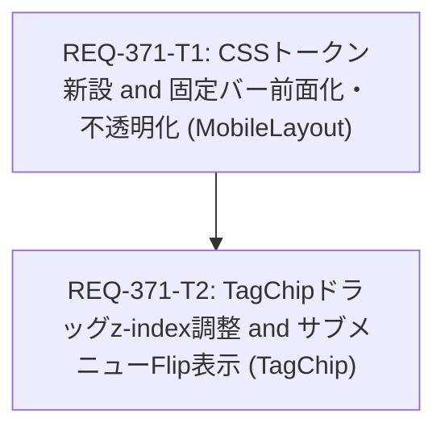

# Implementation Plan - REQ-371: モバイルGenerate：テキスト層による生成ボタンの被覆修正と固定方法の見直し

## User Review Required

> [!IMPORTANT]
> **主要な設計判断と方針（設計書 [REQ-371.md](docs/design/REQ-371.md) 参照）**
> - **CSSスタッキング階層のトークン化 (AC-1, AC-3)**:
>   無効な Tailwind クラス `z-45` を廃止し、正規の設計トークン `--z-mobile-action-bar: 40;` を `frontend/src/index.css` に新設します。階層関係を「通常チップ (z-0〜10) ＜ ドラッグ中チップ (z-30) ＜ 固定アクションバー (z-40) ＜ ボトムナビ (z-50) ＜ 共通Modal (z-100)」と厳密に固定し、プロンプト欄のスクロールやドラッグ移動によってテキストやチップがボタンに被る問題を構造的に解消します。
> - **完全不透明背景による文字透け見え根絶 (AC-1, AC-2)**:
>   アクションバーの背景を半透明 `bg-surface/90 backdrop-blur` から完全不透明な `bg-surface border-t border-[rgba(255,255,255,0.06)]` に変更します。高輝度なテキストやチップがボタン直下に透けて文字衝突を起こす現象を遮断し、タップ判定を単独捕獲（`pointer-events-auto`）して背面要素へのイベント貫通を完全に防ぎます。
> - **下部チップサブメニューの上向き展開 (Flip) (AC-4)**:
>   画面下部付近のチップで詳細編集サブメニューを開いた際、固定アクションバーに隠れて操作不能になることを防ぐため、下部余白不足時にサブメニューを上向き（`bottom-full mb-1.5`）に反転展開する Flip 表示を導入します。これにより、サブメニュー内のタグ名編集、強度調整、削除、コピー、翻訳などの全コントロールが常に確実に操作可能となります。
> - **共通利用画面およびPC表示の非回帰 (AC-5, AC-6, AC-7, AC-8)**:
>   Tag Set 作成・編集画面や LoRA 画面、および幅768px以上のデスクトップ表示に一切の悪影響を与えないことを単体・結合テストで保証します。

---

## Proposed Changes

### Frontend Subsystem: CSS & Generate Mobile Layout

#### [REQ-371-T1: CSSスタッキングトークン新設と固定生成バーの前面化・不透明化](docs/backlog/task/archive/REQ-371-T1.md)
- `frontend/src/index.css`:
  - `:root` に `--z-mobile-action-bar: 40;` を新設。
- `frontend/src/pages/GeneratePage/components/MobileLayout.tsx`:
  - `mobile-action-bar` および `mobile-vram-wait-banner` の無効クラス `z-45` を `z-[var(--z-mobile-action-bar,40)]` に置換。
  - `mobile-action-bar` の背景を完全不透明 `bg-surface border-t border-[rgba(255,255,255,0.06)]` に更新し、`pointer-events-auto` を付与。
- `frontend/src/pages/GeneratePage/components/__tests__/MobileLayout.test.tsx`:
  - スクロール時のテキスト・チップ非透過検証 (`[REQ-371/AC-1]`)
  - ボタンタップ時の背面イベント漏洩遮断検証 (`[REQ-371/AC-2]`)
  - 幅360px、セーフエリア環境でのボトムナビとのスタック配置検証 (`[REQ-371/AC-5]`)
  - スクロール末尾余白への到達性とキーボード退避検証 (`[REQ-371/AC-8]`)
  - 高速タップ連打耐性 Red Team 検証 (`[REQ-371/AC-2] [RedTeam] RT-1`)

---

### Frontend Subsystem: TagChip Component & Submenu Flip

#### [REQ-371-T2: TagChipドラッグz-index適正化と下部チップサブメニューのFlip表示](docs/backlog/task/archive/REQ-371-T2.md)
- `frontend/src/components/TagChipEditor/TagChip.tsx`:
  - ドラッグ時インラインスタイル `zIndex: isDragging ? 50 : undefined` を `zIndex: isDragging ? 30 : undefined` に変更（アクションバー z-40 より下層化）。
  - チップ下部余白の判定ロジックを追加し、下部マージン不足時にサブメニューを `bottom-full mb-1.5`（上向き）に展開。
- `frontend/src/components/TagChipEditor/__tests__/TagChip.test.tsx`:
  - ドラッグ中 z-index が 30 であり固定バー背面に位置する検証 (`[REQ-371/AC-3]`)
  - 下部チップでのサブメニュー上向き反転および全項目操作性検証 (`[REQ-371/AC-4]`)
  - TagSet / LoRA 等の共通利用画面での非回帰検証 (`[REQ-371/AC-6]`)
  - デスクトップ表示および十分な下部余白時の下向き維持検証 (`[REQ-371/AC-7]`)
  - 最下端境界でのエラーフリー展開 Red Team 検証 (`[REQ-371/AC-4] [RedTeam] RT-2`)

---

## Dependency & Implementation DAG



---

## Verification Plan

### Automated Tests
1. **Gate 1: 静的型チェック**
   ```bash
   cd frontend && npm run typecheck
   ```
2. **Gate 2: ユニット＆結合テスト (局所実行)**
   ```bash
   cd frontend && npx vitest run src/pages/GeneratePage/components/__tests__/MobileLayout.test.tsx -t "REQ-371"
   cd frontend && npx vitest run src/components/TagChipEditor/__tests__/TagChip.test.tsx -t "REQ-371"
   ```
3. **Gate 2: リグレッション検証 (Full Suite)**
   ```bash
   cd frontend && npm test
   ```
4. **Gate 3: Red Team 境界値・異常系検証**
   - RT-1: 固定生成バー高速連打時の背面イベント漏洩遮断テスト
   - RT-2: 最下端境界チップクリック時のサブメニュー安全Flipテスト

---

## Trade-Offs and Risks Disclosure

1. **半透明ブラー (`backdrop-blur`) の廃止と視覚的トレードオフ**:
   - **トレードオフ**: アクションバーの背景を半透明ブラー（`bg-surface/90 backdrop-blur`）から完全不透明（`bg-surface`）に変更することにより、モダンなグラスモーフィズム調の透け感は失われます。
   - **採用理由**: ユーザー報告にある「スクロール時にテキストやチップの文字・装飾がボタンに被って読めない・押しにくい」不具合の根本解決を最優先としました。完全不透明化によって背景文字のコントラスト衝突や視覚的ノイズを100%防止でき、同時にモバイル端末での GPU 負荷（スクロール時のカクつき）を軽減できます（SPEC_COMMON §1-5-1 #10「Backdrop Blur Choke防御」に合致）。
2. **サブメニューの展開方向切り替え (Flip) による操作感の変化**:
   - **トレードオフ**: 通常は下方に展開されるタグ詳細メニューが、画面下部にあるチップでのみ上方に展開されるため、展開方向が位置によって変化します。
   - **採用理由**: 下方に展開し続けると固定バーの前面に覆いかぶさって生成操作を妨げるか、あるいは固定バーの背面に隠れてサブメニューが押せなくなる二者択一に陥るため、利用可能な可視領域（上方）に逃がすスマート Flip が最もアクセシビリティの高い標準的アプローチとなります。
3. **ドラッグ時 z-index の 30 への引き下げ**:
   - **トレードオフ**: 旧来の `zIndex: 50` から `30` に引き下げることで、将来的に `z-31`〜`z-39` の要素が追加された場合にそれらより背面になる制約が生じます。
   - **採用理由**: 現行仕様において通常チップは `z-10`、固定バーは `z-40` であるため、`z-30` は「通常チップ群より前面に浮き上がりつつ、固定アクションバーの背面に潜り込む」という要求仕様（AC-3）を正確に満たす唯一の最適値です。

---

## Local Model BA Audit & Disposition

- **Audit Tool**: `local_model_adapter.py ba-audit --audit-kind design` (Local Model: `qwen/qwen3.5-9b`, Context: 32768)
- **Package SHA-256**: `84caf1a232b1ba7116533e07e84a543aabf0abc192e1d63d1dfbe02f5e96ca6e`
- **Result Status**: `ISSUES_FOUND`
- **Findings & Disposition Matrix**:
  | Finding ID | 種別 | 対象ユニット | 指摘内容 | 判定 (Disposition) | 詳細理由 |
  |---|---|---|---|---|---|
  | **F-001** | MISSING_COVERAGE | REQ-371-T1 | AC-3, AC-4 の実装計画が未記載 | **not-applicable** (仕様通りの責務分割) | AC-3 (ドラッグz-index) および AC-4 (Flipサブメニュー) は、後続タスク REQ-371-T2 が完全に担保する設計。 |
  | **F-002** | MISSING_COVERAGE | REQ-371-T1 | AC-6 の検証・実装計画が未記載 | **not-applicable** (仕様通りの責務分割) | AC-6 (TagSet/LoRA画面非回帰) は、TagChip コンポーネントを改修する REQ-371-T2 が担当。 |
  | **F-003** | MISSING_COVERAGE | REQ-371-T1 | AC-7 の検証・実装計画が未記載 | **not-applicable** (仕様通りの責務分割) | AC-7 (デスクトップ表示非回帰) は、TagChip コンポーネントのテストを受け持つ REQ-371-T2 が担当。 |
  | **F-004** | MISSING_COVERAGE | REQ-371-T2 | AC-1, AC-2, AC-5, AC-8 の実装が未記載 | **not-applicable** (仕様通りの責務分割) | AC-1, AC-2, AC-5, AC-8 は、先行タスク REQ-371-T1 が MobileLayout および CSS トークンで完結して担保する設計。 |

- **VRAM Cleanup**:
  - `local_model_adapter.py unload` 実行確認済み（LM Studio reports no models loaded、VRAM 解放完了）。


