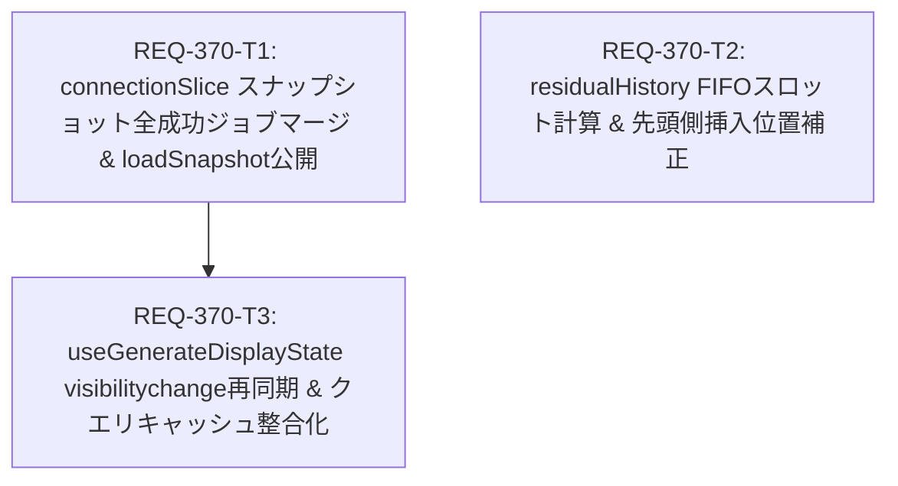

# Implementation Plan - REQ-370: 複数端末における生成履歴同期抜けの修正

## Proposed Changes

複数端末および複数セッションでの画像生成において、他端末で生成された画像の履歴同期抜け、リロード時の残存履歴切り捨て、および挿入位置逆転を解消するため、フロントエンドの 3 つのコンポーネント（`connectionSlice.ts`, `residualHistory.ts`, `useGenerateDisplayState.ts`）を改修します。

---

### Task 1: `REQ-370-T1` - connectionSlice スナップショット全成功ジョブの包括マージと loadSnapshot 公開
- **Subsystem**: `frontend`
- **Impacted Files**:
  - `frontend/src/store/slices/connectionSlice.ts`
  - `frontend/src/store/types.ts`
  - `frontend/src/store/__tests__/slices/connectionSlice.test.ts`
- **Description**:
  1. `applyGenerationSnapshot` において、`completedJobs` の抽出条件を「直前状態からの遷移」から「スナップショット内に存在する全 `status === 'succeeded'` かつ `outputs` を持つジョブ（`succeededJobs`）」へ変更し、`mergeManagedHistory` に渡してマージします（`AC-1`）。
  2. `ConnectionActions` および `createConnectionSlice` の戻り値に `loadSnapshot: (automaticEpoch?: string) => Promise<void>` を追加し、外部から明示的にスナップショット再同期を行えるようにします。
  3. `connectionSlice.test.ts` の旧仕様テスト（初期スナップショットのマージを行わないアサーション）を、全成功ジョブがマージされる新仕様テスト（`[REQ-370/AC-1]`）へ更新します。
- **Verification Command**:
  ```bash
  npm --prefix frontend test -- connectionSlice.test.ts -t "REQ-370/AC-1"
  npm --prefix frontend run typecheck
  ```

---

### Task 2: `REQ-370-T2` - residualHistory FIFO スロット上限計算と差分画像の先頭側挿入位置補正
- **Subsystem**: `frontend`
- **Impacted Files**:
  - `frontend/src/services/residualHistory.ts`
  - `frontend/src/services/__tests__/residualHistory.test.ts`
- **Description**:
  1. `mergeResidualHistory` において、既存件数（`existingAllCount`）に基づく事前スロット切り捨て（`200 - existingAllCount`）を撤廃し、差分候補をすべて受容した上でマージ後配列全体を `slice(0, 200)` する最新優先・最古追い出し（FIFO Eviction）方式へ改修します（`AC-2`）。
  2. `insertAfterPrior` において、先行差分キーが見つからない場合（初回ページ）の挿入位置を配列末尾（`base.length`）から配列先頭（`0`）へ変更し、時系列整合性を確保します（`AC-3`）。
  3. `residualHistory.test.ts` に `[REQ-370/AC-2]`（200件保持時の新規差分受容・FIFO維持）および `[REQ-370/AC-3]`（先頭挿入）のテストケースを追加・更新します。
- **Verification Command**:
  ```bash
  npm --prefix frontend test -- residualHistory.test.ts -t "REQ-370/AC-2"
  npm --prefix frontend test -- residualHistory.test.ts -t "REQ-370/AC-3"
  npm --prefix frontend run typecheck
  ```

---

### Task 3: `REQ-370-T3` - useGenerateDisplayState タブ復帰時スナップショット再同期とクエリキャッシュ整合化
- **Subsystem**: `frontend`
- **Impacted Files**:
  - `frontend/src/pages/GeneratePage/hooks/useGenerateDisplayState.ts`
  - `frontend/src/pages/GeneratePage/hooks/__tests__/useGenerateDisplayState.residual.test.tsx`
- **Description**:
  1. `useGenerateDisplayState.ts` の `handleVisibility`（`document.visibilityState === 'visible'`）において、`void store.loadSnapshot()` を実行し、バックグラウンド復帰時のスナップショット整合性を再検証します（`AC-4`）。
  2. Zustand ストアと TanStack Query キャッシュの同期エフェクト（L445-455）において、ストアにマージされた新規画像が `currentQueryData` に即座に取り込まれるようマージ処理を補正します。
  3. `useGenerateDisplayState.residual.test.tsx` に `[REQ-370/AC-4]`（タブ復帰時のスナップショット再同期およびクエリキャッシュ反映）のテストケースを追加します。
- **Verification Command**:
  ```bash
  npm --prefix frontend test -- useGenerateDisplayState.residual.test.tsx -t "REQ-370/AC-4"
  npm --prefix frontend run typecheck
  ```

---

## Dependency Graph & Execution Order



- **並行実行性**: `REQ-370-T1` と `REQ-370-T2` はファイルおよび責務が直交しており並行実行可能です。`REQ-370-T3` は `REQ-370-T1` で公開される `loadSnapshot` を呼び出すため、`REQ-370-T1` 完了後に実行します。

---

## Technical Trade-offs & Risks

| 設計論点 | 採用方針 | 検討された代替案と却下理由 |
|---|---|---|
| スナップショット適用時のジョブマージ範囲 | スナップショット内の全 `succeeded` ジョブ（`outputs.length > 0`）をマージ対象とする | **直前スナップショットからの状態変化のみを対象とする（現行）**: 初回接続時や HTTP 再同期時に既完了ジョブが脱落する根本原因であったため却下。<br>**WebSocket イベントでのみ履歴追加する**: タブ非表示時や接続断時のイベントロストに対応できないため却下。 |
| 残存差分マージ時の上限管理 | **最新優先・最古追い出し（FIFO Eviction: 新規候補を受け入れて先頭側に挿入し、末尾の最古要素を 200 件上限で切り詰め）** | **事前空き枠計算（現行 `200 - count`）**: 既存履歴が 200 件に達すると新しい画像が一切追加されなくなるため却下。 |
| 残存差分の挿入位置 | **配列先頭（インデックス 0）への挿入** | **配列末尾（現行）**: 新規画像が最古画像の後ろに追記され、時系列認知が逆転するため却下。 |
| タブ復帰時の同期契機 | **`loadSnapshot()` による軽量スナップショット照会** | **`fetchHistory()` による ComfyUI 全履歴取得**: タブ切り替えごとの ComfyUI `/history` API は重く、サーバー負荷が高いため却下。 |
| WebSocket Push と HTTP Pull の競合 | **`applyGenerationSnapshot` 内の revision チェックとシグネチャによる冪等性保証** | **排他ロック導入**: 非同期リクエストのシーケンス番号（`httpRequestSequence`, `snapshotApplySequence`）による世代管理が既存実装されており、ロック待ちによるデッドロックリスクを避けるため既存世代管理を活用。 |

---

## Verification Plan

### Automated Baseline 3-Gate Verification
1. **Gate 1 (Typecheck Baseline)**:
   ```bash
   npm --prefix frontend run typecheck
   ```
2. **Gate 2 (Focused Test Suite Baseline)**:
   ```bash
   npm --prefix frontend test -- connectionSlice.test.ts residualHistory.test.ts useGenerateDisplayState.residual.test.tsx
   ```
3. **Gate 3 (Tag Filter Acceptance & Red Team)**:
   - `npm --prefix frontend test -- connectionSlice.test.ts -t "REQ-370/AC-1"`
   - `npm --prefix frontend test -- residualHistory.test.ts -t "REQ-370/AC-2"`
   - `npm --prefix frontend test -- residualHistory.test.ts -t "REQ-370/AC-3"`
   - `npm --prefix frontend test -- useGenerateDisplayState.residual.test.tsx -t "REQ-370/AC-4"`
