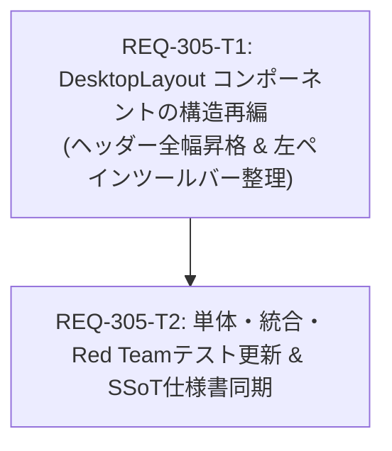

# Implementation Plan - REQ-305: デスクトップ生成画面におけるグローバルヘッダー全幅昇格および左ペインツールバー順序整理

デスクトップ生成画面（`DesktopLayout.tsx`）において、左ペイン内に取り残されていたグローバルヘッダーを画面最上部（全幅）へ昇格させ、その直下に全幅プリセットタブバーを配置します。また、左ペイン最上部ツールバーの配置を `justify-between` から左寄せ（`justify-start`、`gap-2`、`flex-nowrap`）に変更し、左から「プリセット名」→「Undo/Redo」→「Add Set」→「管理」の順序で連続配置します。

---

## Proposed Changes

### Frontend Subsystem

#### [LOCAL MODIFY] [DesktopLayout.tsx](file:///c:/Users/audih/ws/comfy-create-helper2/frontend/src/pages/GeneratePage/components/DesktopLayout.tsx)
- ルートコンテナの最上位に Global Header を配置（`w-full px-5 py-3 border-b bg-surface/50 flex-shrink-0 relative z-20`）。
- その直下に `#desktop-preset-tabs-bar` を配置（`w-full border-b bg-surface-2/40 px-5 py-2 flex-shrink-0 relative z-10`）。
- `leftPane` 内から旧ヘッダー要素を除去。
- `leftPane` 最上部の `#left-pane-toolbar` から `justify-between` を除去し、`justify-start gap-2 flex-nowrap` として「プリセット名バッジ」→「Undo/Redoボタングループ」→「Add Setボタン」→「管理ボタン」の順序で左寄せ配置。

#### [LOCAL MODIFY] [DesktopLayout.tabs.test.tsx](file:///c:/Users/audih/ws/comfy-create-helper2/frontend/src/pages/GeneratePage/components/__tests__/DesktopLayout.tabs.test.tsx)
- Global Header が最上位に全幅で描画されること（AC-1）を検証するテストを追加。
- プリセットタブバーが Global Header 直下かつスプリットレイアウト直上に全幅で描画されること（AC-2）を更新検証。
- `#left-pane-toolbar` が `justify-start` かつ指定順序（プリセット名、Undo/Redo、Add Set、管理）で描画されること（AC-3）を検証。
- 境界値（空プリセット、未選択、最小幅リサイズ時の非折り返し）の Red Team テストを追加。

### Documentation / Specifications

#### [LOCAL MODIFY] [SPEC_GENERATE.md](file:///c:/Users/audih/ws/comfy-create-helper2/docs/specs/SPEC_GENERATE.md)
- Section 2「デスクトップレイアウト (`DesktopLayout`)」の階層図および構成テーブルを最新構成に同期更新。

---

## Verification Plan

### Automated Tests
1. **コンポーネント単体・統合テスト**:
   - `cd frontend; npx vitest run src/pages/GeneratePage/components/__tests__/DesktopLayout.tabs.test.tsx`
2. **生成画面統合回帰テスト**:
   - `cd frontend; npx vitest run src/pages/__tests__/GeneratePage.test.tsx`
3. **型チェック (Static Typecheck)**:
   - `cd frontend; npm run typecheck`
4. **フルテストスイート (Full Discovery Suite)**:
   - `cd frontend; npm test`

### Manual Verification
1. デスクトップ画面でブラウザを開き、画面最上部に「Generate」タイトルとワークフロー選択プルダウンが画面全幅で表示されていることを確認。
2. その直下に全幅のプリセットタブバーが横スクロール可能に表示されていることを確認。
3. 左ペインの最上部に、左から順に「プリセット名」「Undo/Redo」「Add Set」「管理」が近接して並んでいることを確認。
4. 左ペインの幅をドラッグして広げても、ボタン群が右端へ逃げず左側にまとまっていることを確認。

---

## Task Dependency & Parallelization

| タスクID | サブシステム | 対象ファイル | 依存関係 | 検証コマンド |
| :--- | :--- | :--- | :--- | :--- |
| **REQ-305-T1** | frontend | `DesktopLayout.tsx` | なし (Root) | `cd frontend; npm run typecheck` |
| **REQ-305-T2** | frontend / docs | `DesktopLayout.tabs.test.tsx`, `SPEC_GENERATE.md` | `REQ-305-T1` | `cd frontend; npx vitest run src/pages/GeneratePage/components/__tests__/DesktopLayout.tabs.test.tsx` |

---

## Trade-off Disclosure

1. **上部固定バーによる垂直スペース消費と解決策**:
   - **Trade-off**: ヘッダー（約48px）と全幅タブバー（約40px）が画面上部に2段積まれるため、コンテンツ領域の縦幅が合計約88px消費されます。
   - **Mitigation**: 左ペイン内部から旧ヘッダーが撤廃されるため、左ペイン入力欄自体の縦スペースは実質的に縮退せず、むしろ表示領域が拡大します。プレビュー側もタブバー全幅化の一覧性向上が上回ります。
2. **オーバーレイドロップダウンの重なり（z-index）**:
   - **Trade-off**: 最上部ヘッダーのワークフロー選択やSettingsポップオーバーが直下のタブバーと重なる可能性があります。
   - **Mitigation**: グローバルヘッダーに `relative z-20`、タブバーに `relative z-10` を適用し、確実にドロップダウンが前面に展開されるようにスタッキング階層を設計しています。