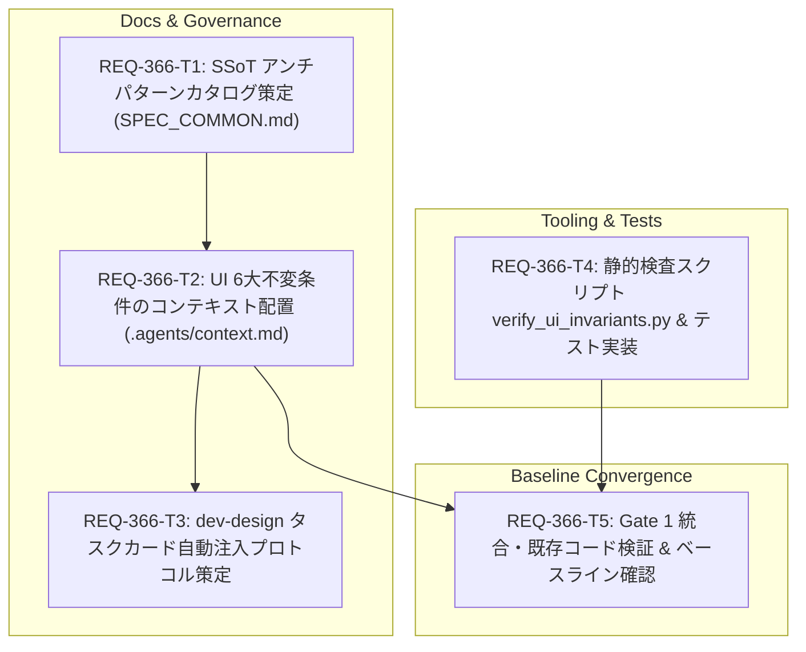

# Implementation Plan: REQ-366 デザインルールの定義にアンチパターンの定義を追加（UI/UX ガバナンス・3層パイプライン整備）

UI/UX改修における「一括文字底上げ（11px Floor）」や「二重パディング」などの対症療法による二次災害・レイアウト崩壊を撲滅するため、「SSoTカタログ」「共通6大ハード不変条件」「Task Cardサージカル注入」「Gate 1機械的即死」からなる3層パイプラインを確立し、エージェント駆動開発のコンテキスト汚染をゼロにしつつ機械的な品質統制を実現します。

## Proposed Changes

### Documentation & SSoT Subsystem

#### [LOCAL MODIFY] [SPEC_COMMON.md](file:///c:/Users/audih/ws/comfy-create-helper2/docs/specs/SPEC_COMMON.md)
- **1-5. UI/UX アンチパターンカタログ & 4大コンポーネントプリセット新設 (AC-1)**:
  - モバイル10選（Global Font Floor、Flex truncate不発、中央モーダル、二重パディング、タッチ判定密集/誤肥大、IME衝突、input判定雑駁、英単語突き抜け、ジェスチャー競合、過剰ブラー）を体系化し、Bad/Goodコード例を明記。
  - PC8選（超ワイド崩壊、OS拡大率崩れ、ペイン幅固定、ホバー依存、ショートカット欠落、一括操作欠落、多重スクロールバー、多重モーダル）を体系化。
  - **4大コンポーネントプリセット (Tailwind構文付き)**:
    1. `Modals & Overlays`: モバイル下部ボトムシート (`fixed inset-x-0 bottom-0 max-h-[90dvh]`), スクロール保護 (`overscroll-contain`), 半透明/軽量ブラー (`backdrop-blur-sm` <=8px), PC中央配置。
    2. `Tabs / Chips / Grids`: 横スクロールチップ (`shrink-0 whitespace-nowrap`), Flex文字省略保護 (`min-w-0 flex-1 truncate`), 改行保護 (`break-words`), レスポンシブグリッド。
    3. `Forms & Controls`: Hit-Slop透明判定拡張 (`relative before:absolute before:-inset-2 before:content-['']`), ジェスチャー保護 (`touch-action: pan-y / manipulation`), label判定適正化, IME遮蔽保護。
    4. `Shell & Page Layout`: 生の `100vh` 禁止 (`100dvh`), Ultra-Wide上限 (`max-w-7xl mx-auto`), DPI拡大率 (125%/150%) 耐性 (`max-h-[...] overflow-y-auto`), スクロール一元化。
  - 重要情報の非省略ルール（エラーメッセージ、ID、ステータス表示への安易なtruncate禁止と折り返し/展開導線）を明記。

---

### Governance & Context Subsystem

#### [LOCAL MODIFY] [context.md](file:///c:/Users/audih/ws/comfy-create-helper2/.agents/context.md)
- **UI 6大ハード不変条件のコンテキスト配置 & プリセット参照 (AC-2)**:
  - 全エージェントが初動で読み込む `.agents/context.md` に、構文レベルで判定可能な「UI 6大ハード不変条件」（No Global Font Floor, Viewport Units [Shell], Mobile Modals [Modals], Strict Input Guard [Forms], Flex Truncate [Tabs/Chips], Desktop Container [Shell]）をコンパクト（約300〜500トークン）に追記。
  - 詳細仕様・4大プリセット・コード例は `SPEC_COMMON.md#1-5` への参照ポインタとする。
- **Gate 1 検証コマンドの更新 (AC-4)**:
  - Gate 1 コマンド一覧に `backend\.venv\Scripts\python scripts/verify_ui_invariants.py` を追加。

#### [LOCAL MODIFY] [governance.md](file:///c:/Users/audih/ws/comfy-create-helper2/.agents/rules/governance.md)
- **Architect アーキタイプ分類 & 4プリセット サージカル自動注入プロトコルの策定 (AC-3, AC-5)**:
  - Architect がフロントエンド改修タスクを4大アーキタイプ（Modals & Overlays, Tabs/Chips/Grids, Forms & Controls, Shell & Page Layout）に分類する設計手順を規定。
  - 分類されたアーキタイプに対応するプリセット制約および推奨 Tailwind クラス（Hit-Slop `before:absolute before:-inset-2`、ジェスチャー `touch-action: pan-y / manipulation`、チップ `shrink-0 whitespace-nowrap`、`overscroll-contain`、`min-w-0 flex-1 truncate` 等）のみを Task Card の `<constraints>` にサージカルに自動挿入する規約を明文化。
  - `subsystem: backend` のタスクには UI 制約を一切含めず、コンテキスト汚染とトークン浪費を完全に防止する規約を明文化。

---

### Tooling & Gate 1 Subsystem

#### [LOCAL NEW] [verify_ui_invariants.py](file:///c:/Users/audih/ws/comfy-create-helper2/scripts/verify_ui_invariants.py)
- **Gate 1 即死静的チェックスクリプト実装 (AC-4)**:
  - `frontend/src` 配下の CSS, TSX, TS, JSX ファイルを走査し、禁止構文を即時検出（<1秒で実行完了）。
  - 判定ルール:
    - `rule-no-global-font-floor`: html/body/汎用セレクタでの font-size: 11px 底上げ
    - `rule-no-raw-100vh`: コンテナ高さでの生 100vh 単位
    - `rule-no-indiscriminate-important`: CSS内の !important 乱用
  - 例外機構:
    - インラインコメント `/* ui-invariant-ignore: <rule-id> reason: <理由> */` または `// ui-invariant-ignore: ...` による明示例外のサポート。
    - 移行期用のレガシー除外設定（allowlist）。
  - 違反時は Exit Code 1、クリーン時は Exit Code 0 を返却。

#### [LOCAL NEW] [test_ui_invariants.py](file:///c:/Users/audih/ws/comfy-create-helper2/backend/tests/governance/test_ui_invariants.py)
- **ガバナンステスト実装 (AC-4)**:
  - チケット名を含まないテストファイルとして新設。
  - 各禁止ルールの検出、例外コメントの動作、CLI Exit Code を検証するテストケース（`[REQ-366/AC-4]` タグ付与）。

#### [LOCAL MODIFY] [index.css](file:///c:/Users/audih/ws/comfy-create-helper2/frontend/src/index.css)
- **レガシー例外注釈付与 (AC-4)**:
  - 既存の `frontend/src/index.css` のレガシー記述（!important や font-size 底上げ箇所）に対して、正当な理由付きの `/* ui-invariant-ignore: ... reason: legacy baseline ... */` を付与し、既存機能を壊さずに静的検査を通過させる。

---

## Task Dependency & Parallel Execution Plan [MUST [G-4-4]]



| Task ID | Title | Impacted Files | Parallelizable | Dependencies |
| :--- | :--- | :--- | :--- | :--- |
| **REQ-366-T1** | SSoT UI/UX アンチパターンカタログの正式策定 | `docs/specs/SPEC_COMMON.md` | YES (Track 1 Root) | なし |
| **REQ-366-T2** | 共通UI 6大ハード不変条件のコンテキスト配置 | `.agents/context.md` | NO | `REQ-366-T1` |
| **REQ-366-T3** | dev-design タスクカード自動注入プロトコルの策定 | `.agents/rules/governance.md`, `docs/design/REQ-366.md` | NO | `REQ-366-T2` |
| **REQ-366-T4** | 静的検査スクリプト scripts/verify_ui_invariants.py とテスト | `scripts/verify_ui_invariants.py`, `backend/tests/governance/test_ui_invariants.py` | YES (Track 2 Root) | なし |
| **REQ-366-T5** | Gate 1 統合・既存コード検証 & ベースライン確認 | `.agents/context.md`, `frontend/src/index.css` | NO | `REQ-366-T2`, `REQ-366-T4` |

---

## Verification Plan

### Automated 3-Gate Baseline

1. **Gate 1: Static Typecheck & UI Invariant Check**
```bash
backend\.venv\Scripts\python scripts/verify_ui_invariants.py
backend\.venv\Scripts\mypy backend
cd frontend && npm run typecheck
```

2. **Gate 2: Unit & Governance Test Suites**
```bash
backend\.venv\Scripts\python -m pytest backend/tests/governance/test_ui_invariants.py -k "REQ-366 and AC-4"
backend\.venv\Scripts\python scripts/verify_test_naming.py --strict
```

3. **Gate 3: Acceptance Criteria & Red Team Scenarios**
- **AC-1**: SPEC_COMMON.md にモバイル10選・PC8選・4大コンポーネントプリセット（Tailwind構文 `before:absolute before:-inset-2` や `touch-action: pan-y / manipulation` 含む）・重要情報の非省略ルールが存在することを確認。
- **AC-2**: .agents/context.md に6大不変条件が約300〜500トークン以内で簡潔に定義され、4大プリセットへの参照マップとSSoTへのリンクがあることを確認。
- **AC-3 & AC-5**: dev-design規約において、Architectによる4大アーキタイプ分類、FEタスクへのサージカル注入、およびBEタスクの完全除外が規定されていることを確認。
- **AC-4**: 禁止CSSコードが Exit Code 1 で即死遮断され、`/* ui-invariant-ignore: ... */` があれば許可されることを確認。

---

## Trade-off Disclosure [MUST [G-03]]
1. **静的検査（正規表現/字句解析） vs 完全な AST/PostCSS パーサー**:
   - トレードオフ: PostCSS / Stylelint の完全導入は Node.js 依存と設定ファイルの増大（Gate 1 の実行遅延）を招く。
   - 決定: Python 標準ライブラリベースの軽量静的チェックスクリプト（`scripts/verify_ui_invariants.py`）を採用し、Gate 1 の実行速度（<0.5秒）と環境依存ゼロを優先する。
2. **既存レガシー CSS (`index.css`) の扱い**:
   - トレードオフ: 既存の `index.css` に存在する `!important` や font-size 底上げ記述を今すぐ全削除すると、本番画面の既存レイアウト（REQ-334等）が崩壊するリスクがある。
   - 決定: `/* ui-invariant-ignore: ... */` による正当な理由付き明示例外を許容し、新規追加・修正箇所に対して厳格な即死判定を適用する。
3. **コンテキスト記述量 vs 情報網羅性**:
   - トレードオフ: `.agents/context.md` に全アンチパターンの事例を書くとコンテキストトークンが肥大化する。
   - 決定: context.md には「6大不変条件」のみを約300〜500トークンで記載し、詳細は SSoT（`SPEC_COMMON.md`）への参照リンクとする。

